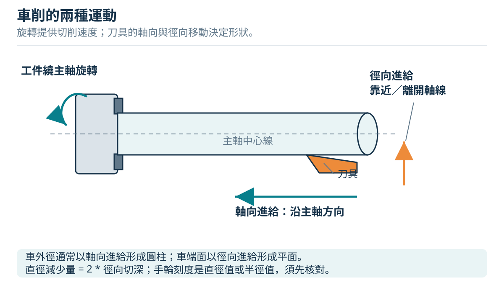

# 朝陽工管｜車床與銑床圖解操作教科書

繁體中文科普教材，共 **10 章、48 頁 PDF、19 張圖解**，從現場照片認識 **WINHO 威赫車床**與**立式膝式銑床**，用圖解、逐步操作與完整練習把切削原理接到實習。



## 開始閱讀

- [完整教科書（GitHub 可直接閱讀）](docs/textbook.md)
- [PDF 列印版](docs/textbook.pdf)
- [章節目錄與原稿](docs/index.md)
- [HTML 閱讀版原檔](docs/index.html)：下載整個儲存庫後，用瀏覽器開啟 `docs/index.html`；內含章節搜尋與算式練習。
- [來源台帳](docs/sources.md)與[圖解索引](docs/assets/README.md)
- [教材驗證紀錄](docs/validation.md)

## 教材內容

| 章 | 主題 | 可完成的學習 |
| --- | --- | --- |
| 1 | 實機照片導讀 | 認識可確認部位、辨別待確認設定 |
| 2 | 安全加工迴圈 | 開機檢查、停止、隔離、清屑與交回 |
| 3 | 車床原理與操作 | 裝夾、中心高、端面、外圓、肩部、倒角、尾座鑽孔 |
| 4 | 階級軸完整實作 | φ25×75 毛胚、φ20／φ16 成品、兩次裝夾與驗收 |
| 5 | 銑床原理與操作 | 軸向、虎鉗校正、換刀、尋邊、順逆銑與回隙 |
| 6 | 槽孔方塊完整實作 | 六面加工、60×40×15 方塊、30×8×3 圓端槽與兩通孔 |
| 7 | 參數與量測 | 轉速、進給、半徑／直徑刻度、公差與量測紀錄 |
| 8 | 異常與品質 | 停機診斷、工序時間與品質改善 |
| 9 | 學習單與評量 | 課前檢核、12 題含解答、操作評量 |
| 10 | 現場核對附錄 | 特定機型確認表與中英名詞索引 |

包含 17 張原創技術示意、2 張實機照片標註圖與 2 張使用者提供的原始照片。每項實作分列動作、目的、量測和確認點；所有算例都清楚標明用途。

## 適用範圍

本書是製造程序實習的科普與受監督操作教材，**非校方核定規程，也不以其他品牌手冊冒充現場手冊**。照片能辨識品牌與部分構造，但完整型號、各手柄功能、主軸介面、啟停、變速、隔離方法和加工參數須現場確認。照片上的散放工具不是合格開機範例。

實作前依原廠手冊、校內規程與教師指導完成第 10 章核對表。尺寸與工序為原創教學設計，尚未宣稱在現場試作通過。CNC 程式、切斷、螺紋與其他進階加工需另行訓練。

## 維護與重建

教材來源在 `docs/chapters/`，圖解來源為可編輯 SVG；PDF 與 HTML 由同一份章節原稿建立。

```powershell
python -m pip install -r requirements.txt
python scripts/generate_figures.py
python scripts/build_book.py
python scripts/validate_book.py
```

PDF 預設使用 Windows 微軟正黑體。其他系統請設定 `CJK_FONT`、`CJK_BOLD_FONT` 指向支援繁體中文的 TrueType 字型（`.ttf` 或 TrueType `.ttc`）；先安裝對應字型再重建。兩張照片標註 PNG 已提供，重建 SVG 不會修改原始照片。

## 來源與授權

原理與安全概念參考朝陽官方資料、CCOHS、MIT、Open Oregon 及刀具／機台／量具製造商的一手文件，章內附直接連結；沒有複製他人圖片。現場照片由使用者提供，保留提供者原有權利，不納入開放再利用授權。

本儲存庫原創教材文字與技術 SVG 採 [CC BY 4.0](https://creativecommons.org/licenses/by/4.0/)；建置程式採 [MIT License](LICENSE-CODE)。照片及包含照片的標註圖不納入前述 CC 授權。詳見 [LICENSE-CONTENT.md](LICENSE-CONTENT.md)。

版本 1.0 · 2026-10-11。
