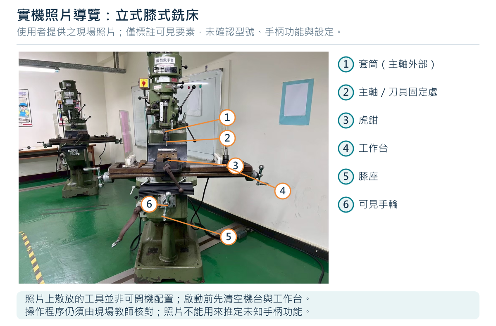

# 01 從照片認識朝陽工管的切削實習

## 這本書怎麼用

車床把圓棒變成階級軸；銑床把方塊變成平面、槽與孔。兩者都把多餘材料切成切屑，但旋轉的東西不同：車床通常是工件旋轉，銑床是刀具旋轉。理解這件事，才能看懂進給方向、尺寸變化與危險區域。

本書為朝陽科技大學工業工程與管理系製造程序實習情境編寫的科普教材，版本 1.0，編製日期 2026-10-11。系上公開設施資料列有製造程序實習工廠 E-101；本書不是校方核定的機台操作規程。閱讀後，應能說明原理、辨認部位、規劃加工與量測，在教師監督下執行已核准的練習。

**閱讀順序：**先讀第 1、2 章，再依課程讀車床第 3、4 章或銑床第 5、6 章；第 7 章用於算式與量測，第 8 章用於停機後判斷，第 9、10 章供課前確認與課後評量。沒有完成現場部位辨識、停機示範與裝夾確認之前，不進入切削步驟。

## 照片能證實什麼

圖 1-1 是使用者提供的現場照片，可見立式主軸、套筒、虎鉗、長形工作台與膝座。依可見構造，本書稱它為「立式膝式銑床」。是否屬砲塔式、品牌、型號、主軸錐度與各手柄功能，仍需現場銘牌和原廠手冊確認。照片上的手柄位置不是加工設定。

圖 1-2 可讀出 **WINHO 威赫車床**品牌，主軸箱面板有速度表、進給／螺紋表，並有「運轉中請勿變速」警示。照片沒有完整呈現刀架、尾座與啟停裝置；品牌不等於型號，也不能由刻度表推定一套可直接照做的手柄組合。

兩張照片用來認識部位。照片中桌面或機台頂部有散放工具，**不能當作已完成開機檢查的示範**。實作前須清空會震落、捲入或干涉的物件，依教師確認的護罩位置操作。照片與本書其他圖解分開標示；線條圖都是原創通用示意，沒有按比例複製現場設備。

## 車床與銑床，哪一台適合這個形狀

| 問題 | 車床 | 立式銑床 |
| --- | --- | --- |
| 誰旋轉？ | 夾頭與工件 | 主軸與刀具 |
| 誰進給？ | 刀架、溜板或尾座套筒 | 工作台或主軸套筒，依工法選用 |
| 最自然的形狀 | 同軸外圓、端面、階級、軸向孔 | 平面、直角、台階、槽、定位孔 |
| 最常用的尺寸觀念 | 直徑、軸向長度、同軸度 | 長寬高、基準、孔位、平行與垂直 |
| 主要裝夾 | 夾頭、頂心、專用治具 | 虎鉗、壓板、專用治具 |
| 首要危險 | 旋轉夾頭與工件捲入、工件甩出 | 旋轉刀刃、刀具斷裂、工作台夾傷 |

加工不是「把數字轉到某格」而已。尺寸來自基準，品質來自剛性、刀具、切削條件與量測，安全來自裝夾、護罩、間隙與正確停機。

## 材料、刀具與切屑的科普

金屬切削可想成刀刃把薄層材料剪下來。刀刃不是靠蠻力刮擦，而是以適合的角度、速度與進給形成切屑。刀具比工件硬，仍可能因撞擊、振動與過熱崩裂。

鋁合金較容易切削，也可能黏刀；低碳鋼切削力通常較大；不鏽鋼容易加工硬化，不能把鋁材的設定直接套用。高速鋼與硬質合金刀具也有不同的切削速度範圍。本書的材料與數值都是教學設計；實際選材須先確認牌號、刀具規格及課程設備能力。

切屑很燙、很尖，長條切屑更可能纏住旋轉物。觀察切屑可協助判斷加工狀態，但不能用手抓，也不能僅憑顏色決定是否安全。出現異常先停機，由教師檢查。

## 先把現場資料填完整

| 現場核對項目 | 車床紀錄 | 銑床紀錄 |
| --- | --- | --- |
| 品牌／型號／設備編號 | 品牌可見 WINHO；其餘待填 | 待填 |
| 原廠手冊與版本 | 待填 | 待填 |
| 正常停止／急停／隔離電源位置 | 待填並示範 | 待填並示範 |
| 護罩、聯鎖與禁止使用情況 | 待填 | 待填 |
| 速度與進給選擇的正式程序 | 待填 | 待填 |
| 手輪每轉／每格、毫米或英制 | 待填，註記半徑或直徑 | 待填，註記軸與方向 |
| 夾頭／刀柄／主軸介面與限制 | 待填 | 待填 |
| 清屑、冷卻液與課後保養規定 | 待填 | 待填 |

**現場規程優先：**原廠手冊、校內核准的作業程序與教師指導，決定啟停、換檔、換刀及護罩操作。本書不替未知的現場手柄編造功能。CNC 車床與 CNC 加工中心的程式、刀具補正、回原點與自動循環，另需專門訓練，不套用本書手動步驟。

來源：[朝陽工管官方設施資料](https://iem.cyut.edu.tw/p/404-1032-61732.php?Lang=en)；兩張現場照片由使用者於本次教材製作提供。品牌與構造辨識僅依照片可見內容。
