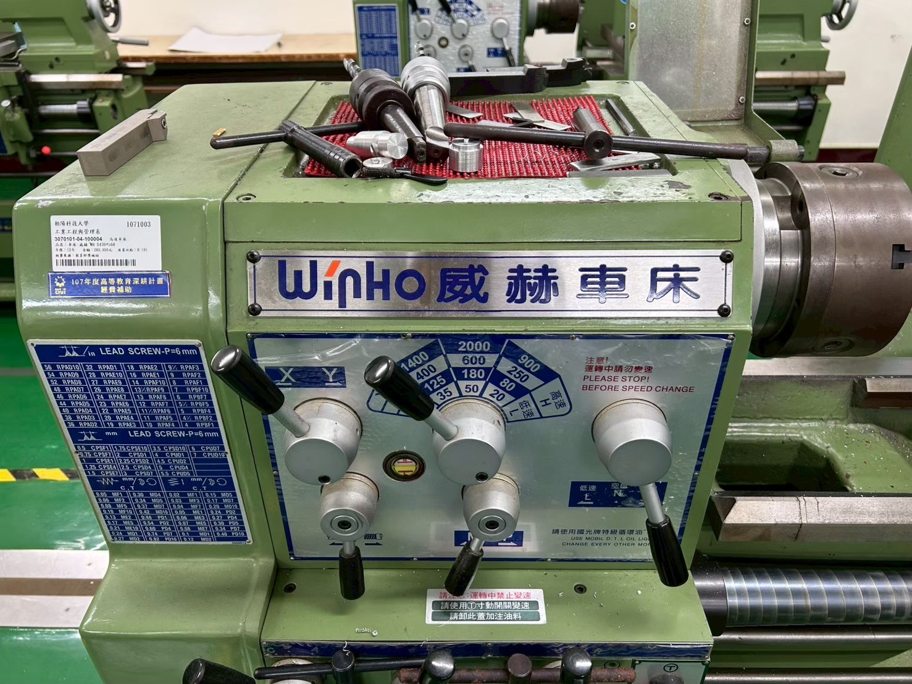
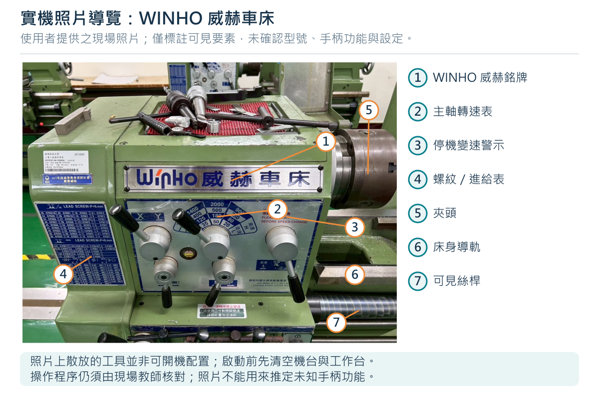
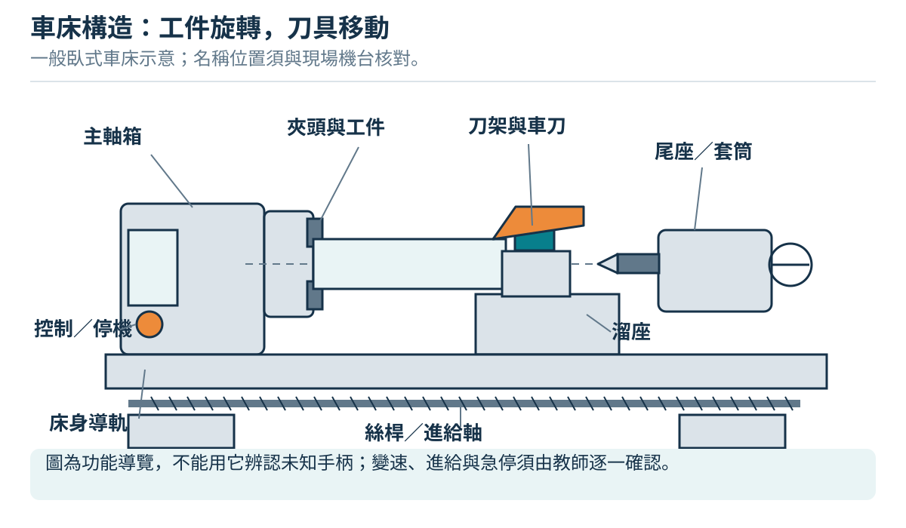
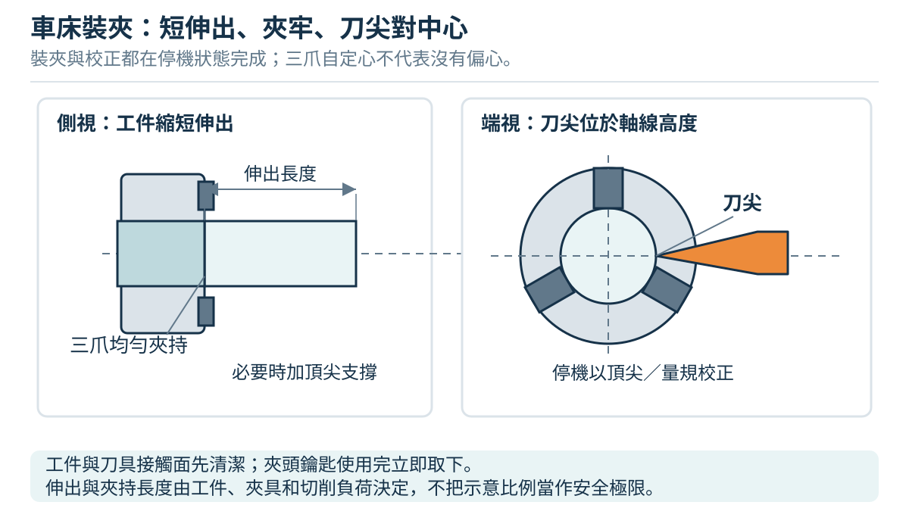
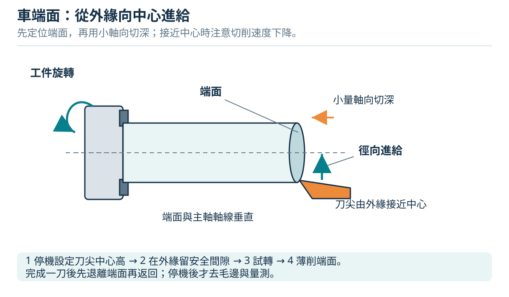
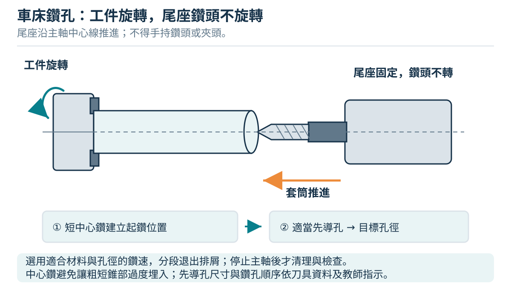

# 03 車床：讓工件旋轉，讓刀具走出形狀

本章適用於教師帶領的傳統中心車床入門。讀者應先完成安全章，再由教師在實機確認啟動、正常停止、緊急停止、主軸方向、換檔與進給控制。**書中的箭頭、手輪名稱與流程是通用示意；未確認的控制桿不得憑圖操作。**

## 3.1 從朝陽現場照片開始認識

提供的照片可辨識「WINHO 威赫車床」品牌、主軸箱、夾頭及面板上的停機換速提醒。照片沒有提供足以核對的完整型號與原廠操作手冊，因此本書不推定各手柄位置、轉速組合、夾頭安裝形式或安全連鎖。面板上的轉速數字必須與該機正確的換檔表一起使用。

照片中主軸箱上方散放刀柄與工具。**這張照片用來辨識設備，不代表可以開機的整理狀態。** 開機前應將鬆散物品移到指定工具盤，清空會掉落、碰撞或滑向旋轉區的位置。照片的校名或財產貼紙只能確認圖片情境，不能代替設備檢查紀錄。

現場依據：使用者提供的實機照片。停機調整與清除機床上工具的原則可核對 [CCOHS 車床安全](https://www.ccohs.ca/oshanswers/safety_haz/metalworking/lathes.html)。

## 3.2 一台車床如何工作

| 部位 | 功能與初學者應辨認的事 |
|---|---|
| 主軸箱、主軸 | 提供旋轉與傳動；工件軸線由主軸決定，換檔不是改變刀具位置。 |
| 夾頭 | 夾持工件並帶動旋轉。夾爪、夾頭外緣與突出物都形成危險旋轉範圍。 |
| 床身與導軌 | 提供移動基準；工具掉落、切屑壓傷與砂粒會損害精度。 |
| 鞍座、拖板 | 使刀具沿工件軸線移動，主要用於外圓加工。 |
| 橫向滑座 | 使刀具靠近或離開軸線；控制外圓直徑，也用於端面進給。 |
| 複式滑座、刀架 | 固定刀具，並提供短距離或角度移動。刀架鎖緊後仍須確認刀具方向與淨空。 |
| 尾座、尾座套筒 | 可裝頂心支撐工件，或裝鑽夾頭沿軸線鑽孔；尾座本體須可靠鎖在床身。 |
| 進給桿、導螺桿 | 將運動傳到拖板。一般進給與螺紋同步進給功能不同，半螺帽不得當成任意的自動進給開關。 |

依據與延伸：[Open Oregon《Manufacturing Processes 4–5》車床構造](https://openoregon.pressbooks.pub/manufacturingprocesses45/chapter/chapter-unit-1-the-engine-lathe/)。圖為本教材原創簡化圖，並非 WINHO 原廠尺寸圖。

## 3.3 三種運動與三個切削量

車削的主運動是工件旋轉。刀具沿軸線進給，就得到圓柱；刀具沿半徑方向進給，就得到端面。刀具既沿軸線又改變離軸距離，才可能得到斜面或錐面。操作前先在紙上畫出「起點、終點、退刀方向」，比只記手輪順逆方向更可靠。

- **轉速 (n)**：主軸每分鐘轉幾圈，單位 rpm。
- **切削速度 (v_c)**：工件表面掠過刀刃的速度，單位 m/min。同一轉速下，大直徑的表面走得較快；端面越接近中心，表面速度越小。
- **每轉進給 (f_n)**：工件轉一圈，刀具走多遠，單位 mm/rev；不是每分鐘進給量。
- **切深 (a_p)**：外圓車削時沿半徑去除的厚度，單位 mm；直徑減少量為 (2a_p)。端面切深則沿軸向計。

計算關係為 **`n = 1000 × v_c / (π × D)`**，其中 (D) 必須用毫米。例如**僅作算術練習**，若給定 (v_c=20) m/min、(D=25) mm，算得約 255 rpm。這不是本校材料的開機建議：實際數值須由教師根據材質、刀具資料、夾持、刀具突出量與機台可用檔位確認，並受夾頭與附件額定轉速限制。不能因為算出 255，就自行組合換檔手柄。

公式來源：[Sandvik Coromant 車削公制公式表](https://cdn.sandvik.coromant.com/files/sitecollectiondocuments/services/metal-cutting-e-learning/formulas-and-definitions/formulas-and-deinitions-for-turning-metric-enu.pdf)。運動辨識可核對 [Grizzly G0600 原廠手冊的 Manual Feed](https://cdn0.grizzly.com/manuals/g0600_m.pdf)，該機控制位置不套用到現場設備。

## 3.4 裝夾：先建立剛性，再開始切削

三爪夾頭的夾爪一起移動，適合圓棒的入門裝夾；它會使圓棒大致置中，但**取下再夾不能保證回到原來軸線**。四爪獨立夾頭需要逐爪校正；筒夾有自己的直徑範圍。新手不得自行換夾頭、反裝夾爪或加裝非標準延長爪。

| 順序／目的 | 動作 | 通過條件 |
|---|---|---|
| 1　防止誤啟動 | 依現場規程停止並禁止啟動；確認主軸完全靜止。刀具先移到不妨礙裝料的位置。 | 操作者與教師確認裝夾期間不會啟動；換車刀、換鑽頭、維修、拆護罩或換夾頭須依第 2 章與現場規程執行能源隔離。 |
| 2　讓接觸面可靠 | 用刷具清除夾爪接觸面與工件上的切屑，檢查毛胚是否彎曲、開裂或有明顯毛邊。 | 三爪接觸的是完整圓柱面，不是斜端、肩部或毛邊。 |
| 3　決定伸出長度 | 依工序只露出必要加工長度，保留教師確認的夾持長度。長細件另評估頂心或支承。 | 夾爪處於允許範圍；所有爪都能有效接觸，工件不靠一小段邊緣勉強夾住。 |
| 4　夾緊並移除扳手 | 使用正確夾頭扳手夾緊，隨即拔出並放回固定位置。不可加套管暴力增力。 | 工件固定；夾頭扳手已離開旋轉區。 |
| 5　裝刀與校高度 | 清潔刀座，使用規定刀柄與最短可行突出量；以教師確認對準的尾座頂心或專用高度規對刀尖。調整後鎖緊，再校一次。 | 刀尖在主軸中心高；刀柄、刀架都不鬆動；刀刃適合預定進給方向。 |
| 6　查全程淨空 | 在禁止啟動的狀態，按原廠允許方法手動檢查轉動與刀具全程；不能手轉時由教師改用核准檢查法，勿硬扳。 | 夾爪最大掃掠範圍不碰刀架、滑座、尾座或護罩，退刀也有空間。 |

刀尖偏高或偏低會改變刃口的工作角度；端面中心留下凸點時，要停機查高度與刀尖狀態，不能一直強壓到中心。尾座頂心若本身未對準主軸，只能作粗略參考，應由教師校核。

夾頭種類依據：[Open Oregon 夾頭單元](https://openoregon.pressbooks.pub/manufacturingprocesses45/chapter/unit-3-chucks/)。中心高核對：[Sherline 原廠操作說明，Leveling the Cutting Tool](https://www.sherline.com/wp-content/uploads/2014/07/5326_instructions_v9_web.pdf)。本表為本教材編排的通用檢查流程，夾持長度必須現場驗證。

## 3.5 刻度、背隙與量測：尺寸差兩倍常出在這裡

橫向手輪可能採「半徑讀值」，也可能採「直徑讀值」；數位尺亦可能切換模式。**不能只看單位 mm 就認定是哪一種。** 先讀本機手冊，再由教師用量表檢查實際滑座位移；不可用猜測進行試切。

| 想將直徑從 20.80 車到 20.40 mm | 刀具實際往中心移動 | 應讀取的變化量 |
|---|---:|---:|
| 半徑式刻度 | 0.20 mm | 0.20 mm |
| 直徑式刻度／直徑模式數位尺 | 0.20 mm | 0.40 mm |

轉動手輪反向時，螺桿與螺帽的間隙會造成手輪動了、滑座尚未動的**背隙**。定位須由同一方向接近目標；若超過，先退到足以消除間隙的位置，再從原方向靠近。不可把反轉後的刻度變化全部當成切深。此方法不能消除工件撓曲、刀具磨耗或機床幾何誤差。

量測流程是「退刀、停機、確認靜止、刷除妨礙量測的屑、清潔量面、量測、記錄」。卡尺適合粗略檢查與長度；外徑分厘卡適合較細的直徑檢查，使用棘輪或定力裝置，不靠手勁硬夾。沿圓柱前、中、後測量，並在同一位置換方向再測，可以找出錐度與不圓的跡象。工件過熱時先讓溫度穩定；顯示到 0.01 mm 不等於量測一定準到 0.01 mm。

刻度案例依據：[Grizzly G4000 原廠手冊，Cross Slide](https://cdn0.grizzly.com/manuals/g4000_m.pdf)；數位尺模式可核對 [MIT Lathe Refresher Guide](https://makerworkshop.mit.edu/wp-content/uploads/2015/03/LatheRefresherGuide.pdf)。定力量測依據：[Mitutoyo 外徑分厘卡說明](https://www.mitutoyo.com/products/small-tool-instruments-and-data-management/micrometers/digimatic-micrometers/coolant-proof-micrometer/)。表內毫米算例為本教材原創。

## 3.6 基本加工：每次都從檢查開始

| 工序 | 目的、動作與停機檢查 |
|---|---|
| 試運轉 | 教師確認護罩就位、鬆散工具收妥、刀具不接觸工件、自動進給與半螺帽在本機規定的解除狀態。按核准方向與檔位啟動，觀察偏擺與異常聲響，再正常停止。若工件滑動或劇烈振動，立即停止並請教師處理。 |
| 車端面 | 使用適合的端面刀。刀尖先位於外徑以外，按核准的少量軸向切深設定位置，再平穩由外向中心進給。接近中心時不越過到刀具不適用的方向；完成後退出接觸、停止，再看平面與中心是否殘留凸點。用完成端面建立軸向長度基準。 |
| 車外圓 | 從端面外側的安全起點開始，設定徑向切深；按刀具適用方向沿軸線走到預定終點。接近夾頭或肩部前提早減緩；到終點解除進給、徑向退刀，再回起點。首次先車一小段，停機量徑核對刻度，確認後才加工全長。 |
| 車階級與肩面 | 從完成端面設定肩部位置，粗車時同時留下直徑與軸向精加工餘量。最後以適合刀具修正肩面，避免側刃與肩壁干涉。刀尖圓弧會留下角部半徑，不得宣稱天然得到完全尖銳的內角。 |
| 倒角 | 停機換用適合刀具或由教師設定刀具角度，確認刀尖與工件稜邊的相對位置。以少量進刀去掉端邊尖角，退刀停機後檢查寬度；C0.5 的 45° 倒角指兩個方向各約 0.5 mm，不是沿斜面量 0.5 mm。 |

一般練習先採手動進給；自動進給僅在教師已示範本機接合、解除與終點控制後使用。不要假設機械擋塊一定能停止主軸或阻止撞車。正常切削完成可以先解除進給並退刀；遇到捲入、鬆脫或碰撞徵兆則優先立即停止，勿冒險繼續退刀。

端面原理核對：[MIT OCW 車床教材](https://ocw.mit.edu/courses/2-670-mechanical-engineering-tools-january-iap-2004/resources/lathe/)。肩部與精車延伸：[Sandvik Coromant Turning Handbook](https://www.sandvik.coromant.com/api/publications/view?fileName=C-1020-18.pdf&url=92df68b7-b8c0-494d-b290-e27f540b5885.pdf)。本表不是上述任一機型的按鍵操作表。

## 3.7 尾座鑽孔：鑽頭不轉，工件轉

1. **先定義深度。** 圖面須說明盲孔深度是到鑽尖，還是完整圓柱孔底；兩者相差鑽尖長度。教師先選擇鑽徑、定位刀、轉速、進給與適用切削液。
2. **停機裝刀與鎖尾座。** 清潔錐孔及錐柄，按本機規定裝入鑽夾頭；鑽頭夾在直柄，不夾螺旋槽，拔下鑽夾頭扳手。鎖定尾座本體，保留套筒工作行程，刀架移出鑽頭路線。錐柄未坐實時不得用手扶住開機。
3. **建立孔口。** 已車平的端面是起點。用合適的定位鑽／中心鑽做起始孔；其角度與深度由教師配合後續鑽頭選定，不把中心鑽的 60° 支承錐孔一律深鑽作任何鑽頭的定位孔。
4. **停機換鑽頭並重查。** 將定位刀退離工件、停止主軸，再換正式鑽頭。確認夾持、尾座鎖定與軸線對準；新刀具伸出量不同，須重做淨空檢查及表面零點設定。
5. **平穩鑽進與排屑。** 啟動後，以尾座套筒手輪受控進刀；按教師核准的分段深度退鑽排屑。正常狀況先將鑽頭退離孔，再停機清屑；不可徒手拉掉旋轉中的切屑。套筒接近行程界限前停止，不為追求深度讓錐柄退出。
6. **完成與檢驗。** 鑽至核准深度後退鑽、停機，確認全靜止，再檢查孔口毛邊與深度。發生鑽頭卡住、鑽夾頭轉動或工件鬆動，立即停止並交教師排除，勿手抓鑽夾頭抗轉。

尾座功能核對：[Haas 傳統車床操作手冊，Tailstock Operation](https://haascnc.com/service/online-manuals/hml-manual-lathe-operators-service-manual/manual-lathe-operation)。定位孔的角度與細鑽對準問題：[Sherline Lathe Alignment and Micro-Drilling](https://sherline.com/wp-content/uploads/2018/05/lathe_align.pdf)。夾頭型式及退錐方法須依現場手冊，不照搬他機。

## 3.8 哪些留給教師示範

| 加工 | 看懂的科普重點 | 本書的操作界線 |
|---|---|---|
| 車螺紋 | 主軸每轉一圈，刀具同步前進一個導程；導程與螺距在多線螺紋中不相同。 | 涉及換齒輪、半螺帽、退刀及再入刀同步；教師示範，不提供新手獨做流程。 |
| 切斷 | 窄刀向中心切入，剩餘截面越來越小；排屑與刀具側向受力很敏感。 | 本書階級軸使用預切毛胚，不需切斷；不得用尾座頂心硬頂住即將分離的切斷段。 |
| 滾花 | 壓花型滾花以滾輪讓金屬塑性變形，形成止滑紋；另有切削型滾花。 | 壓力可能使長細件撓曲，教師選刀具與支承。 |
| 偏心／面盤加工 | 工件質量與旋轉軸不重合，會出現不平衡與較大的掃掠範圍。 | 配重、夾持與額定轉速由教師評估；新手不自行試轉。 |

延伸來源：[Open Oregon 車削單元](https://openoregon.pressbooks.pub/manufacturingprocesses45/chapter/unit-4-turning/)、[Sandvik 螺紋加工指南](https://cdn.sandvik.coromant.com/files/sitecollectiondocuments/downloads/global/technical%20guides/en-gb/c-2920-031.pdf)。

## 3.9 停機、清理與異常處理

每段加工完成後先解除進給、讓刀具離開工件，依本機規定停止，確認夾頭完全靜止才量測或取件。班末依規程禁止啟動，將尖銳刀具收妥，再用刷具、屑鉤或夾具收集切屑；不戴手套接近有旋轉可能的區域，不用手抓屑，也不用壓縮空氣把屑吹進導軌或吹向他人。按指定油品與位置保養，擦除地面油液，記錄刀具與設備異常。

若看到工件位移、刀架轉動、持續尖叫、劇烈振動、長屑纏繞或冷卻液異常，不以增加手力壓住工件。先停止、確認靜止，再由教師檢查夾持、刀具、支承與切削條件。緊急停止後也不自動重啟；必須排除原因、收妥工具並重新完成檢查。

清理原則：[Open Oregon 車床安全與清理](https://openoregon.pressbooks.pub/manufacturingprocesses45/chapter/chapter-unit-1-the-engine-lathe/)；捲入與停機量測原則：[CCOHS 車床安全](https://www.ccohs.ca/oshanswers/safety_haz/metalworking/lathes.html)。

下一章：[階級軸的完整練習](04-lathe-practice.md)。
