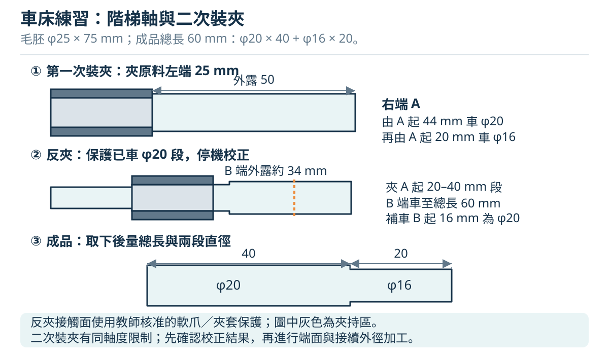

# 04 車床實作：從毛胚到階級軸

本章是一份**原創教學練習設計，尚非朝陽現場實測工序或校方認證標準**。它把第 3 章的裝夾、端面、外圓、肩部、倒角與量測串成可檢查的工作流程。教師須先用實際材料、刀具、夾頭及機台試做，確認夾持、可用轉速與刀具全程淨空，才讓學生分步操作。尾座鑽孔另作短料練習，避免任意改變這份軸件圖面。

## 4.1 讀圖與準備

所有尺寸單位為 mm。以小徑端面命名 **A**，另一端命名 **B**。從 A 沿軸向量 (s)，A 為 (s=0)，肩面位於 (s=20)，B 位於 (s=60)。這個 (s) 是教材座標，不是宣稱實機必有同名數位尺。

| 項目 | 教學目標 | 量測與判定 |
|---|---|---|
| 毛胚 | 約 φ25 × 75，圓直且無明顯缺陷的教師核准材料 | 卡尺實測原始直徑與總長；鋸口不能直接當精密基準。 |
| 總長 A–B | 60 ± 0.30 | 兩端面清潔、去除妨礙量測的毛邊，停機取下後量測。 |
| A 端小徑 | φ16 ± 0.20，軸向長度 20 ± 0.30 | 外徑分厘卡量直徑；卡尺量 A 至肩面。 |
| 大徑 | φ20 ± 0.20 | 在可量區的多個軸向位置與方向量測。 |
| 大徑長度 | 40，參考尺寸 | 由總長減小徑長度得到，避免重複且互相矛盾的長度公差。 |
| 端部外稜 | 示範 C0.5，即約 0.5 × 45° | 去尖角，不讓倒角侵蝕肩面定位長度；是否保留更小倒角由教師定。 |
| 同軸度、粗糙度 | 本練習未指定正式幾何公差或 Ra | 記錄目視接刀痕、直徑差與教師量表檢查；不可用尺寸合格代替同軸度合格。 |

上述公差是本教材設定的練習目標，並非量具、機台或學生能力的保證。材料牌號、硬度、刀具與切削液不確定時，先由教師確認，不能把「看起來像鋁／鋼」當作選速依據。準備外圓刀、端面／肩部適用刀具、倒角刀、刷具、屑鉤、卡尺、0–25 mm 外徑分厘卡，以及教師核准的二次裝夾保護裝置。

讀圖及加工概念核對：[Open Oregon 車削單元](https://openoregon.pressbooks.pub/manufacturingprocesses45/chapter/unit-4-turning/)。尺寸、命名、公差與工序安排為本教材原創。

## 4.2 先畫兩次裝夾，才知道哪些面現在不能車

第一次夾住 B 側未加工的 φ25 原料約 25 mm，A 側外露約 50 mm。車平 A 後，預定加工 A 起約 44 mm 的外圓；其餘原材留到第二次加工。**外露 50 與夾持 25 是這個工序的規劃值，不是通用安全比例**；教師須核對該夾頭、材料、切深及工件剛性。若 A 端面去除量過多，44 mm 加工段與夾爪之間的預留淨空會變小，須重新規劃。

第一次先將 (s=0) 到約 (s=44) 車為 φ20，再將 (s=0) 到 (s=20) 車為 φ16，留下 (s=20) 到 (s=44) 的 φ20 段。第二次**夾持已完成 φ20 上的 (s=20) 到 (s=40) 區間**，夾持長約 20 mm；不把只有 20 mm 長的 φ16 段當作唯一夾持面，再讓整段 φ20 懸伸。

反夾後，A 側朝向夾頭內部；實際夾頭孔徑、內部空間和爪形必須容得下 φ16 段，且夾爪不能壓在肩部或倒角上。B 側原材朝外，原先加工到 (s=44) 的 φ20 保留約 4 mm 外露作接續參考；車平 B 至 (s=60)，再補車 (s=44) 到 (s=60) 約 16 mm 的 φ20。

使用配合 φ20 的合格軟爪、筒夾或教師設計核准的保護夾套，避免夾傷成品。**不得塞紙片、布條或鬆散墊片臨時替代夾套。** 軟爪或夾套還會改變有效接觸長度與定位精度，教師需重新驗證。若現場無法可靠完成這種反夾，就先調整工序或工件尺寸，不直接照做。

夾持附件概念：[Open Oregon 夾頭單元](https://openoregon.pressbooks.pub/manufacturingprocesses45/chapter/unit-3-chucks/)。原廠的裝夾與停機要求可核對 [Haas 傳統車床操作手冊，Chuck Operation](https://haascnc.com/service/online-manuals/hml-manual-lathe-operators-service-manual/manual-lathe-operation)，不可將其夾頭形式視為 WINHO 現場配置。

## 4.3 第一次裝夾：建立 A 基準，完成小徑與反夾面

每次重新裝刀、調整角度或換檔，都在主軸完全停止且依現場規程禁止啟動時進行；換車刀或鑽頭另須按第 2 章與該機規程完成能源隔離。學生每完成一道就讓教師確認下一道起點與終點；下表不省略第 3 章的護罩、扳手與淨空檢查。

| 步驟 | 目的與實際動作 | 停機檢查／下一步門檻 |
|---|---|---|
| 1　原料檢查 | 實測毛胚；指定 A、B，確認至少有加工與夾持餘量。把預定肩部、第一次終點和反夾區畫在工序圖上。 | 無彎曲、裂縫；教師確認材料與刀具。尺寸不足時換料或改圖，不強行使用。 |
| 2　停機裝料 | 清潔爪面與毛胚；依 4.2 夾 B 側，設定外露長度後夾緊，立即收回夾頭扳手。 | 夾持完整圓柱面，爪位在允許範圍；教師檢查偏擺與夾持。 |
| 3　裝刀試轉 | 校中心高、刀柄突出量與全程淨空；收妥工具，解除自動進給及半螺帽，護罩就位。用教師核准檔位作不接觸工件的試轉，再停止。 | 無明顯偏擺、鬆動與異音。主軸方向配合刀刃；現場警示要求停機換檔。 |
| 4　車平 A | 用端面刀少量去除鋸切面，按第 3 章端面步驟車到形成完整平面。退刀停機。 | A 面完整，中心無異常凸點；剩餘外露仍足夠加工 44 mm 並保持夾爪淨空。 |
| 5　建立軸向零點 | 以完成 A 面建立教師核准的軸向讀值或量表基準，記錄肩部 20 mm 和第一加工終點 44 mm。 | 讀值單位、方向與零點有紀錄；實機沒有可靠拖板刻度時由教師用量表／行程量測，不估算手輪圈數。 |
| 6　外圓試切 | 在 A 側先車一小段，使用教師核准的小切深。退刀停機，量直徑，核對半徑／直徑刻度及背隙。 | 計算的直徑減少量與實測相符；否則停止釐清，不連續進刀猜答案。 |
| 7　粗車 φ20 | 從 A 側外端起刀，分次車到約 44 mm 終點，提早停止進給，退刀再回程。粗車留直徑精加工餘量，例如留至約 φ20.4；實際值由教師配合刀具確認。 | 每次停機記錄直徑，不只量一端；未車到夾爪附近。粗車餘量是直徑值，不可直接當半徑切深。 |
| 8　精車 φ20 | 量測後算所需徑向切深，從相同方向消除背隙並設定刀位；先試一短段再量測，確認後完成全段。 | 直徑符合目標；(s=20) 到 (s=40) 保留無倒角、無肩部干涉的完整反夾面。 |
| 9　粗車 φ16 | 依 A 零點設定小徑長度；粗車到肩部前留軸向餘量，不先越過 20 mm 再想補回。分次車小徑並保留直徑餘量。 | 肩部位置仍可修正；刀刃與肩面有淨空，沒有長屑纏繞。 |
| 10　完成 φ16 與肩面 | 按量測結果精車小徑，並用適合刀具將肩面收至 A 起 20 mm。需要換刀時重新校刀位，不能沿用舊刀尖零點。 | 停機量 φ16、A–肩面長度，檢查肩面、刀尖圓角與兩段直徑。 |
| 11　A 邊倒角與取件 | 用核准倒角刀少量去掉 A 外稜，退刀停止。依規程禁止啟動，移開刀具，托住工件再鬆爪取下。 | 工件冷卻後再量測；A–B 剩餘總長記為 (L_1)，保留第一裝夾紀錄。 |

上述 φ20.4 是原創練習的餘量示例，不能推定特定刀片在 0.2 mm 半徑切深必然得到良好切屑。切削參數須符合刀具適用範圍，過小切深也可能摩擦或形成不良表面。公式核對：[Sandvik 車削公式](https://cdn.sandvik.coromant.com/files/sitecollectiondocuments/services/metal-cutting-e-learning/formulas-and-definitions/formulas-and-deinitions-for-turning-metric-enu.pdf)；試切、停機量測概念核對：[MIT 車床教材](https://ocw.mit.edu/courses/2-670-mechanical-engineering-tools-january-iap-2004/resources/lathe/)。

## 4.4 第二次裝夾：控制總長，補完大徑

三爪反夾會引入徑向偏心與軸向定位變化。此練習接受由教師評估的教學接續效果，**不宣稱兩次裝夾就能取得精密同軸階級軸**。有正式同軸度要求時，應改由教師規劃兩頂心、校正四爪或其他可控工法。

反夾後，A 可能位於夾頭內，不能用旋轉中的卡尺跨過夾頭量總長，也不能假想 A 面仍然可見。本練習提供兩種由教師選用的長度控制方式：有可靠軸向定位裝置時，用其設定 B 的加工量；沒有可靠裝置時，採**停機取件量總長、重新裝夾校正**，每次只修少量，並保留重夾所需校正時間。

| 步驟 | 目的與實際動作 | 通過條件 |
|---|---|---|
| 12　計算端面餘量 | 根據第一次取件實測的 (L_1)，算 B 端尚需去除量 (L_1-60)。先規劃收至約 60.5 mm，再量測，不一刀按鋸料公稱 75 mm 減去 15 mm。 | 有實測值、目標值和待去除量，單位一致。 |
| 13　保護反夾與校正 | 停機，清潔 φ20 夾持段與保護裝置；夾在 (s=20) 至 (s=40)，避免肩面與倒角。教師以量表、允許的手動轉動檢查外露 φ20 的偏擺，再確認夾緊。 | φ16 可安全容入夾頭內部；有效接觸、剛性與刀具路線合格。量表及其支架在啟動前移開。 |
| 14　重查刀位與試轉 | 反夾後重新確認中心高、端面刀位置、轉向及全程淨空，再作不接觸工件試轉。 | 工件無晃動；原先 φ20 的外露接續帶可辨認。 |
| 15　B 端粗修長度 | 以當前 B 表面為相對起點，按本機確認的軸向位移少量車端面，先保留總長約 0.5 mm 的修整餘量。 | 停機取下後量總長；若未用可靠定位裝置，每次重夾都重新校正，不能沿用取件前零點。 |
| 16　精修至總長 60 | 以取件實測與剩餘餘量決定下一次端面切除量；由教師確認後再夾、校正、修面，直到公差內。 | 記錄最終 A–B 長度；尺寸已短於下限時不能再靠車削補救，需記錄不合格原因。 |
| 17　補車 B 側 φ20 | 從 B 外側車向已有 φ20 接續帶，粗車留餘量；停機量測後精車至目標。只接到原加工面，不越過夾爪掃掠範圍。 | 在 B 側、接續帶、可量的原 φ20 區間量測；直徑差與接刀痕如實記錄。接刀痕不可靠在旋轉工件上纏砂布處理。 |
| 18　B 邊倒角 | 停機設定倒角刀，檢查與爪的距離，再少量加工 B 外稜；退刀停機取下。 | 端面有效量測面仍存在；倒角無明顯尖稜，總長與直徑複驗合格。 |

裝夾精度與夾具原理可核對 [Open Oregon 夾頭單元](https://openoregon.pressbooks.pub/manufacturingprocesses45/chapter/unit-3-chucks/)。再裝夾及長度控制方案為本教材針對本練習設計，須現場試做。

## 4.5 品質紀錄與常見錯誤

取件後待溫度穩定，清潔量面，以同一量具與定力方式重複量測。大徑前、中、後測量後再轉向量一次；小徑同樣量至少兩個軸向位置。把實測值寫下來，再比較公差，不能只記「合格」。長度以原本的端面與肩面為基準，避開倒角及刀尖圓角。

| 檢查項目 | 記錄格式 | 如何判讀 |
|---|---|---|
| φ20 | B 側／接續處／近肩部，各量 0°、90° 方向 | 軸向差異可能為錐度、接刀差或撓曲；方向差異提示不圓，但不足以代替正式圓度量測。 |
| φ16 | 近 A、近肩部，各量兩方向 | 比較平均大小與最大差；不能只量剛好合格的位置。 |
| 長度 | 總長、A 至肩面，至少重複兩次 | 由總長減小徑長度得到大徑參考長度。 |
| 表面與邊緣 | 接刀痕、振紋、毛邊、夾傷；必要時拍照 | 外觀只能找異常，不能由照片判定 Ra 或同軸度。 |
| 過程 | 毛胚、夾持位置、刀具、核准轉速／進給／切深、量具、教師確認 | 同樣尺寸出現不同結果時，這些紀錄才可用來分析原因。 |

| 問題 | 常見原因 | 下一步 |
|---|---|---|
| 直徑一次少了兩倍預期 | 把半徑刻度當成直徑，或計算後又重複除／乘 2 | 停機，用實際滑座位移和量測結果重新核對模式。已車小無法補回。 |
| 肩部長度超過目標 | 未建立 A 基準、換刀未重設或接近終點未提前減速 | 記錄誤差；下件先留下軸向精加工餘量。 |
| B 面越修越短 | 使用公稱毛胚長度，或重夾後沿用舊零點 | 使用每次取件實測總長與新定位基準。 |
| 兩次加工的 φ20 有台階 | 反夾偏心、刀具位移或重設刻度失誤 | 教師停機校正夾持與刀位；不盲目再車到最小直徑。 |
| 振紋、尖叫、錐度 | 工件／刀具突出過長、鎖緊不足、刀刃狀態或切削條件不合 | 停機查剛性與刀具，請教師決定支承和參數；勿徒手扶工件。 |
| 量測重複性差 | 毛邊、切屑、工件熱、量具未歸零或測力不一致 | 清潔、穩溫、校核量具及定力方式後再量。 |

定力與量具規格核對：[Mitutoyo 分厘卡說明](https://www.mitutoyo.com/products/small-tool-instruments-and-data-management/micrometers/digimatic-micrometers/coolant-proof-micrometer/)。刻度差異核對：[Grizzly G4000 手冊](https://cdn0.grizzly.com/manuals/g4000_m.pdf)。振動原因的延伸閱讀：[Sandvik Turning Handbook](https://www.sandvik.coromant.com/api/publications/view?fileName=C-1020-18.pdf&url=92df68b7-b8c0-494d-b290-e27f540b5885.pdf)。

## 4.6 分開練習尾座鑽孔

教師另提供短而可靠夾持的圓棒，先車平端面，再按第 3 章尾座流程練習定位與鑽孔。例如可設計「φ6 盲孔、鑽尖深度 12 mm」的**原創練習題**；材料、定位刀角度、分段排屑深度、鑽速與鑽頭尖角由教師確認。這個 12 mm 已明定到鑽尖，完整 φ6 圓柱孔的有效深度會較小，不能寫成完整孔深 12 mm。

學生須先把端面接觸點設為深度起點，記錄套筒初始讀值及可用行程；完成定位後停機換刀並重設接觸點。逐段鑽進、正常退鑽、停機清屑，到深度後退刀、停機、取件。孔深需使用合適量具與教師指定測量法；一般卡尺深度桿碰到錐面時，不一定量到鑽尖的最深點。若要練習有明確圓柱深度的孔，應另設圖面並計入鑽尖長度。

定位與鑽尖角度核對：[Sherline Lathe Alignment and Micro-Drilling](https://sherline.com/wp-content/uploads/2018/05/lathe_align.pdf)。尾座動作核對：[Haas Tailstock Operation](https://haascnc.com/service/online-manuals/hml-manual-lathe-operators-service-manual/manual-lathe-operation)。

## 4.7 下課前完成交接

停機確認夾頭靜止，依規程禁止啟動；取件與量具收妥、尖銳刀具移開後，用刷具和屑鉤清屑。切屑依材料分類，油液與地面擦淨，按教師指定位置保養。最後交付成品、工序紀錄與不合格說明，並口頭指出本機正常停止、緊急停止與換速限制。

學生應能回答：為什麼先車 φ20 再車 φ16？為什麼反夾選 φ20 的完整圓柱段？為什麼取件再夾須重建基準？為什麼直徑公差合格仍不能保證同軸度？能說明這些問題，才表示理解了「夾持—基準—加工—量測」的關係。

停機、清理與不碰旋轉工件的原則：[CCOHS 車床安全](https://www.ccohs.ca/oshanswers/safety_haz/metalworking/lathes.html)。回看：[車床原理與基本操作](03-lathe.md)。
