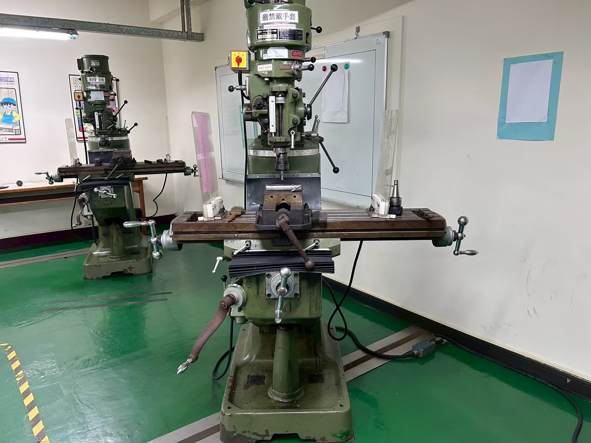
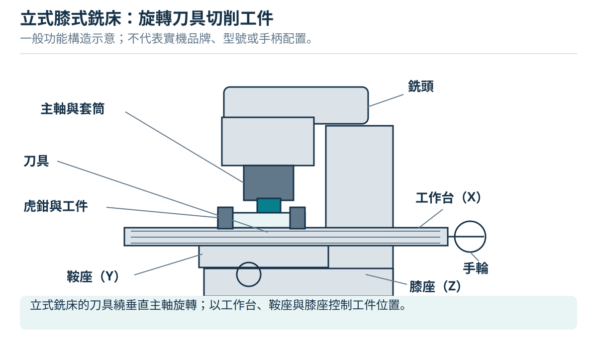
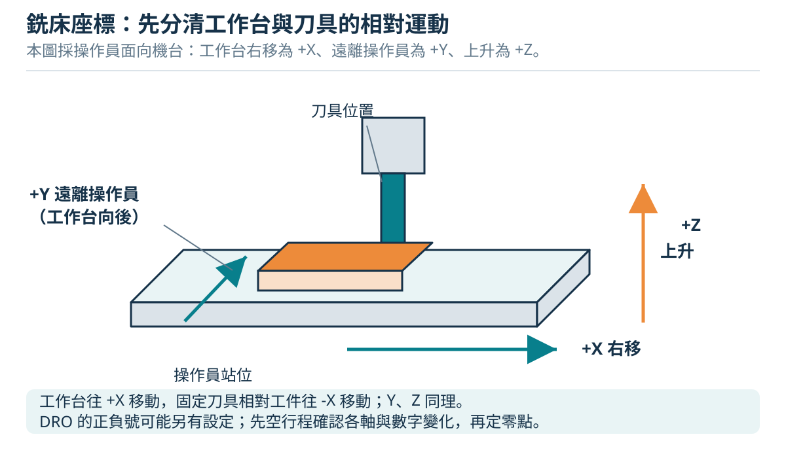
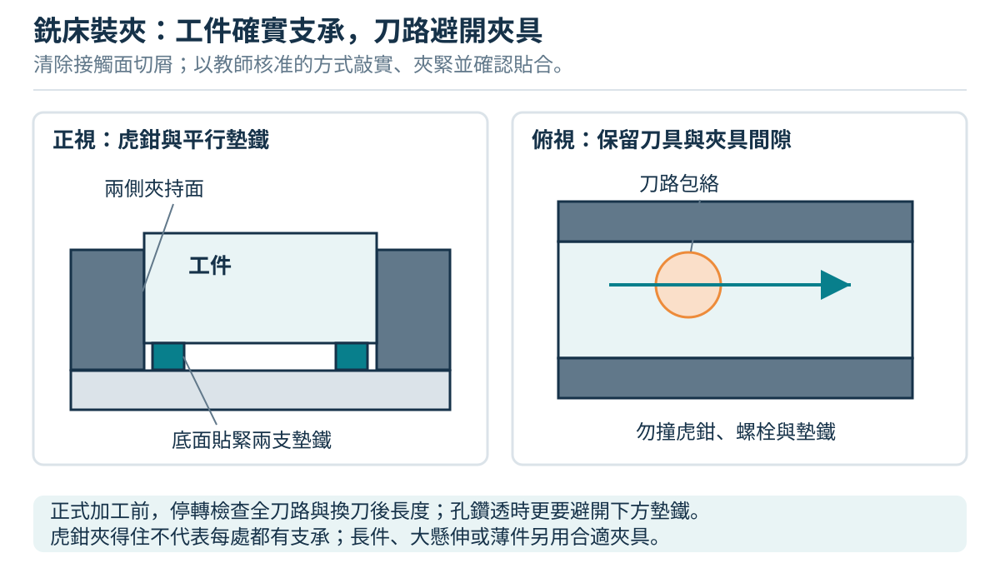
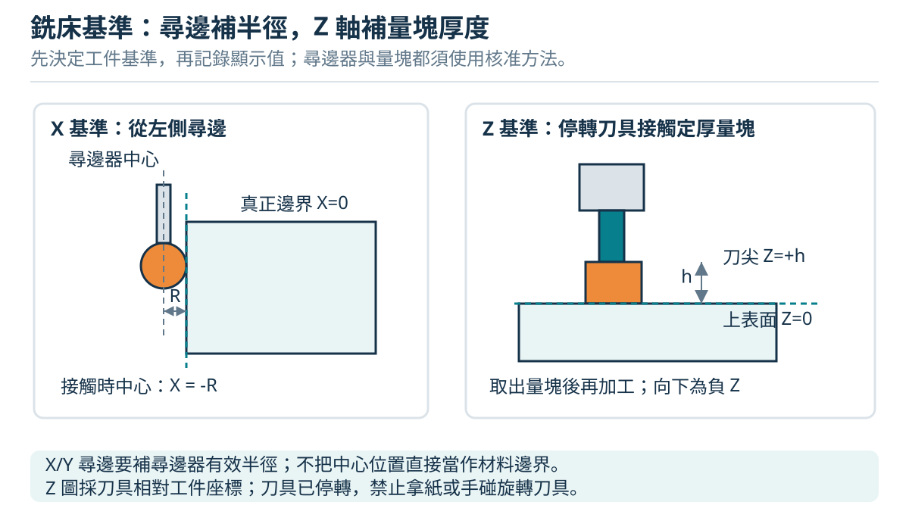
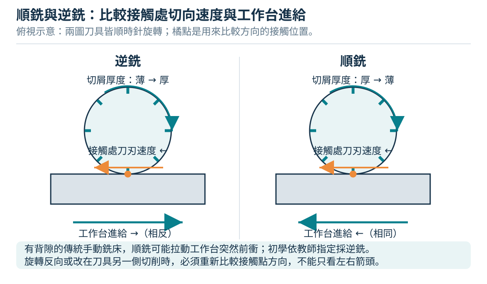

# 05 立式膝式銑床：依照片辨識與操作原理

> 適用範圍：使用者提供照片中的立式膝式銑床，以及同家族機台的入門原理與受監督實習。照片可辨識主軸、套筒、虎鉗、工作台與膝座；廠牌、型號、夾頭規格、變速方式及控制功能尚待現場確認。砲塔與滑枕未清楚入鏡，不能判定該機就是砲塔式。先完成本書的現場機台確認表，再由教師示範啟停、變速、軸鎖及停機方法。




照片是部位辨識資料，不是完整合格的開機狀態示範：台面可見散放刀柄、工具與兩側護屏，開機前須清空散放物並確認護罩位置及功能。機台上「嚴禁戴手套」的標示清楚可見，操作與換刀均遵守現場規定。不能由手柄外形或按鈕顏色猜測功能。

## 5.1 認識構造與加工方式

銑床用多刃刀具旋轉，讓被夾住的材料依指定方向移動，逐層形成平面、側面、台階、槽或孔。工件固定在虎鉗內仍會跟隨工作台移動；「固定」表示工件不能在夾具內滑動。



| 部件 | 功能與要看懂的事 |
|---|---|
| 主軸與刀柄 | 傳遞旋轉與切削力；刀柄、筒夾及拉桿必須彼此匹配 |
| 主軸套筒（quill） | 短行程上下移動，常供鑽孔與微調；伸出越長，系統越容易撓曲 |
| 銑頭；部分機型另有滑枕、砲塔 | 砲塔式家族可調整主軸位置與方向；照片不足以確認本機具備哪些調整，初學者由教師處理 |
| 工作台、鞍座 | 工作台左右走，鞍座前後走；T 型槽用於固定虎鉗或夾具 |
| 膝座／升降台 | 使整個工作台升降；切削前依機台程序鎖住不需運動的部分 |
| 手輪、刻度環、DRO | 顯示移動量；DRO 是位置顯示器，不能消除螺桿回隙造成的機械危險 |

辨識延伸：CNC 加工中心另有程式、刀長補正、工作座標及快速移動。本章的手輪流程不可搬到 CNC 面板；CNC 必須另受訓。

來源：[Grizzly 砲塔式銑床官方手冊（G9901 系列，僅作構造參考）](https://cdn0.grizzly.com/manuals/g9901_m.pdf)、[MIT《Introduction to the Mill》](https://ocw.mit.edu/courses/2-670-mechanical-engineering-tools-january-iap-2004/69ddc43986801c51a7fbfa97d6b5b63f_mill.pdf)。

## 5.2 軸向：先分清楚誰在動



圖中的 +X／+Y／+Z 描述工作台實體移動；以下工件座標描述刀具相對工件位置。兩套位置的正負號須分開辨認，不把台面移動符號直接當成工件加工座標讀值。

本書工件座標定義為：從操作者看，X 向右、Y 向機台後方、Z 向上。這是**刀具相對工件**的位置。例如刀具要在工件座標往右 10 mm，固定銑頭的機台必須讓工作台往左 10 mm。套筒向下或工作台向上都會使刀具切得更深。現場 DRO 可設定不同符號，先在安全空間做小量試移，核對「手輪—實體台面—讀值—刀具相對位置」四者，再記在操作卡；不能只背順時針或逆時針。

換向時，螺桿可能先空轉才帶動工作台，這段失去運動稱為**回隙**。用手輪刻度定位，要依教師核可方法先消除定位方向的空程，最後從同一方向接近目標；超過目標後不可只反轉一小格假定工件已退回。用 DRO 也要確認實際進給與夾持穩定。

來源：[MIT 銑床教材：手輪刻度與回隙](https://ocw.mit.edu/courses/2-670-mechanical-engineering-tools-january-iap-2004/69ddc43986801c51a7fbfa97d6b5b63f_mill.pdf)。上述座標與小量試移記錄為本教材的原創教學約定。

## 5.3 虎鉗校正、平行墊鐵與夾持



1. **停機並依程序隔離動力。** 清潔台面、虎鉗底部及固定面，移走毛邊；目的是讓接觸面真正貼合。
2. **裝上銑削用虎鉗。** 以適配的 T 型螺帽、螺柱及壓板固定，校正階段保留可微調阻力；不可用未核可的桌上虎鉗或鑽床虎鉗替代。
3. **主軸不轉，用量表掃固定鉗口。** 讓探頭沿可靠平面讀取兩端差值，以手輪移動工作台，微調虎鉗方向，直到符合教師指定容許值。鎖緊底座後重掃一次，避免鎖緊時跑位。
4. **放入等高、潔淨的平行墊鐵與工件。** 墊鐵提供支承與加工高度，不能懸空偏擺。依核可方法讓工件坐實，再夾緊；確認接觸與支承，不用手晃著試夾力。
5. **檢查整條刀路。** 刀刃、刀柄、鑽尖及退刀都須避開鉗口、螺栓與墊鐵。需要露出的加工面越多，夾持面通常越少；不能為了銑到邊而把工件只夾一小條。

來源：[Grizzly 官方手冊：銑削虎鉗安裝與校正](https://cdn0.grizzly.com/manuals/g9959_m.pdf)、[Sherline 銑床虎鉗的支承與鉗口設計](https://www.sherline.com/product/3551-milling-vise/)。上述檢查順序是原創整理，不代表朝陽的現場 SOP。

## 5.4 裝刀與換刀

立銑刀會承受側向力與拔出力，應用規格相符的銑削筒夾或專用刀柄；**鑽夾頭不得夾立銑刀作側銑**。刀柄要夾在有效刀柄部位，不能夾刀刃；伸出長度以完成刀路及淨空所需為限。

換刀前停止進給、停主軸、等待完全停止，再按該機廠商與現場程序隔離動力。整理安全的取放空間，使用教師核可的刀具護套或承接方法，手避開裸露刀刃並遵守「嚴禁戴手套」。放鬆拉桿時持續支承刀具；自解錐式、敲擊退錐式、動力拉刀裝置的步驟不同，敲擊方式、鬆開程度及扭矩由該機手冊決定，不能混用。**未承接刀具，不可把拉桿完全旋出；刀具可能突然落下。**

裝回前清潔接合面，核對規格與夾持長度，依手冊鎖緊，取下扳手、鑽夾頭鑰匙、刀具護套及換刀工具後才可恢復動力。換刀後重新確認刀長／Z 基準，不能沿用上一把刀的高度。

來源：[Grizzly 官方手冊：拉桿裝卸刀具](https://cdn0.grizzly.com/manuals/g9902_m.pdf)、[Grizzly 官方手冊：禁止鑽夾頭銑削](https://cdn0.grizzly.com/manuals/g0876_m.pdf)、[Haas 銑削夾頭與筒夾說明](https://www.haascnc.com/haas-tooling/mill_toolholding/milling_chucks_colle.html)。

## 5.5 尋邊、基準與 Z 零點



先選已加工、可重複接觸的表面作基準。尋邊器接觸的是側邊，主軸中心離該邊還有尋邊器半徑，必須補正；例如接觸頭直徑 10 mm，半徑就是 5 mm。接觸左側邊時，依本書座標，刀具中心在 X = −5 mm；不能把那個位置直接當 X = 0。

機械旋轉尋邊器只有在規格、轉速、裝夾及操作方法由教師確認後，才能按其廠商程序使用；探頭接觸後退開並重複確認，不把身體伸近觀看。電子探頭是否需轉動依其說明，兩者不能混用。**禁止拿紙片靠近旋轉刀具測間隙。**

Z 基準可用核可的量塊、設定器或停轉刀具的接觸程序建立。若設定器厚 h、上表面定 Z = 0，刀端接觸設定器頂面時刀端位於 Z = +h，必須處理厚度偏移。定位後移走設定器，核對已移除，再在工件外安全位置確認 Z 正負與淨空。重夾、移動銑頭或改變基準後，重新建立相關零點。

來源：[MIT：尋邊器與半徑補正](https://ocw.mit.edu/courses/2-670-mechanical-engineering-tools-january-iap-2004/69ddc43986801c51a7fbfa97d6b5b63f_mill.pdf)、[CCOHS 銑床安全](https://www.ccohs.ca/oshanswers/safety_haz/metalworking/millingmachines.html)。座標數例為原創例子。

## 5.6 順銑、逆銑與回隙



看刀刃接觸工件處的切向速度，與**工件實體進給方向**比較：同向是順銑（climb/down），相反是逆銑（conventional/up）。不可只看刀具轉向或只說「向左就是逆銑」，換到刀具另一側就會改變。

順銑的切屑由厚變薄，但切削力可能把台面拉向刀具；有回隙時會突然吃刀。逆銑的切屑由薄變厚，也可能把工件抬起，因此兩種都要求可靠支承與夾持。傳統機台的初學者先使用教師核可的逆銑刀路；順銑須確認廠商允許、進給系統能控制回隙、夾持與參數已驗證才選用。把刻度的空程取完，不等於機台具備消除回隙裝置。滿槽切削兩側同時受切，不能把它當成單一側面的順逆銑。

來源：[Sandvik：Down milling vs. up milling](https://www.sandvik.coromant.com/en-gb/knowledge/milling/down-milling-vs-up-milling)。

## 5.7 轉速與進給：理解單位再設定

以有效切削直徑 D（mm）、切削速度 Vc（m/min）、主軸轉速 n（r/min）、每齒進給 fz（mm/齒）、有效齒數 z 計算：

```text
n = 1000 × Vc ÷ (π × D)
工作台進給 vf = fz × z × n    [mm/min]
```

**原創算式例，不能直接用於朝陽現場：** 假設 D = 10、Vc = 25、fz = 0.02、z = 4，則 n ≈ 796 r/min，vf ≈ 63.7 mm/min。這只是四個假設數的換算，並非任何材質或刀具的建議值。實際需查材料、刀具廠商資料與機台限制，再由教師核可轉速、進給、軸向切深 ap 及徑向吃刀 ae；滿槽、面銑及鑽孔不能共用一組設定。

皮帶式變速須先隔離動力並按手冊處理；部分變速銑頭的調速要求主軸運轉，齒輪檔位又可能要求停轉。**先辨識現場機型及程序，不猜操作。**

來源：[Sandvik 銑削公式與符號](https://www.sandvik.coromant.com/en-gb/knowledge/machining-formulas-definitions/milling-formulas-definitions)、[Grizzly G0728–31 官方手冊的皮帶變速例](https://cdn1.grizzly.com/manuals/g0730_m.pdf)。

[上一章](04-lathe-practice.md) · [下一章：銑床實作](06-milling-practice.md)
