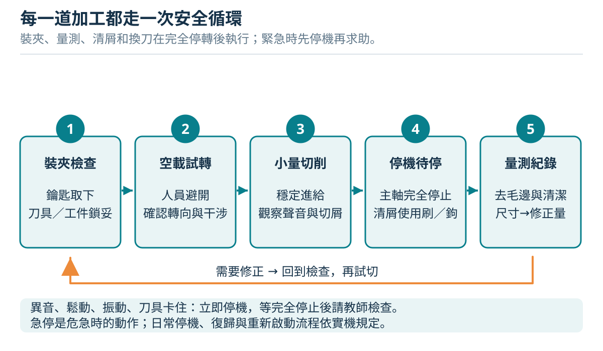
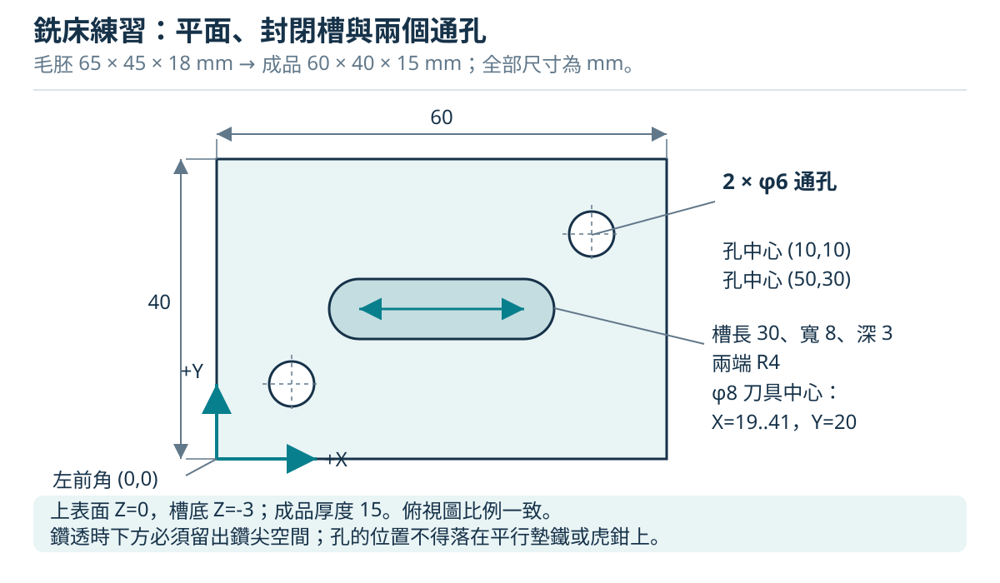
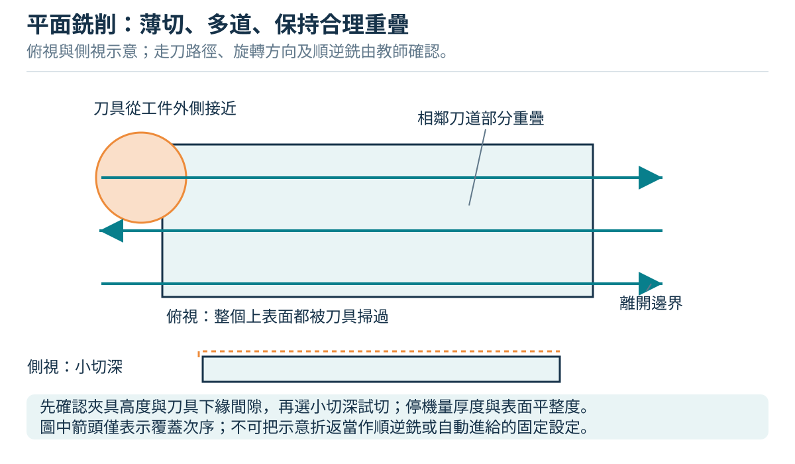
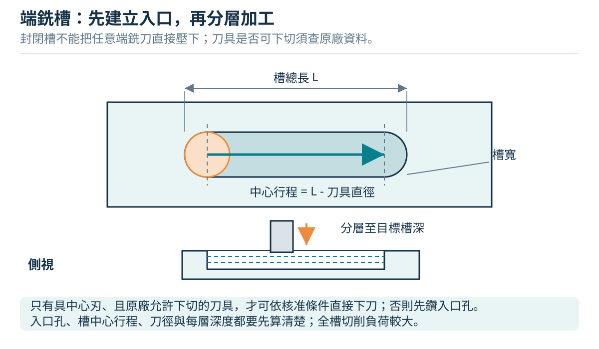
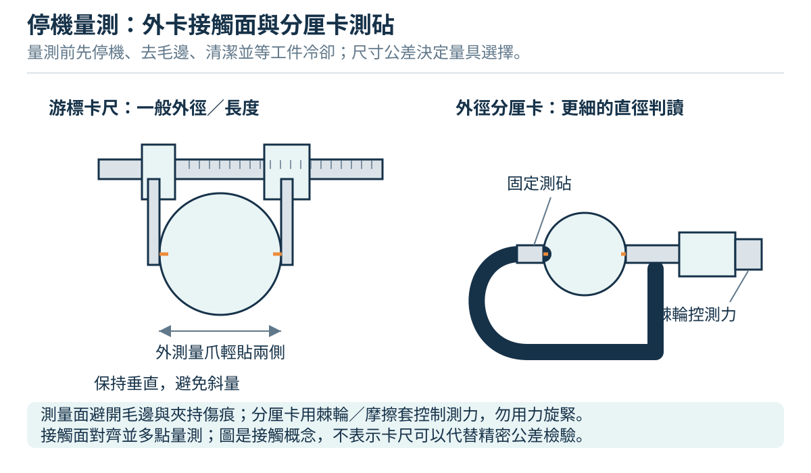

# 車床與銑床：圖解操作教科書

朝陽工管製造程序實習 · 科普入門與受監督操作

版本 1.0 · 2026-10-11

# 01 從照片認識朝陽工管的切削實習

## 這本書怎麼用

車床把圓棒變成階級軸；銑床把方塊變成平面、槽與孔。兩者都把多餘材料切成切屑，但旋轉的東西不同：車床通常是工件旋轉，銑床是刀具旋轉。理解這件事，才能看懂進給方向、尺寸變化與危險區域。

本書為朝陽科技大學工業工程與管理系製造程序實習情境編寫的科普教材，版本 1.0，編製日期 2026-10-11。系上公開設施資料列有製造程序實習工廠 E-101；本書不是校方核定的機台操作規程。閱讀後，應能說明原理、辨認部位、規劃加工與量測，在教師監督下執行已核准的練習。

**閱讀順序：**先讀第 1、2 章，再依課程讀車床第 3、4 章或銑床第 5、6 章；第 7 章用於算式與量測，第 8 章用於停機後判斷，第 9、10 章供課前確認與課後評量。沒有完成現場部位辨識、停機示範與裝夾確認之前，不進入切削步驟。

## 照片能證實什麼


圖 1-1 是使用者提供的現場照片，可見立式主軸、套筒、虎鉗、長形工作台與膝座。依可見構造，本書稱它為「立式膝式銑床」。是否屬砲塔式、品牌、型號、主軸錐度與各手柄功能，仍需現場銘牌和原廠手冊確認。照片上的手柄位置不是加工設定。


圖 1-2 可讀出 **WINHO 威赫車床**品牌，主軸箱面板有速度表、進給／螺紋表，並有「運轉中請勿變速」警示。照片沒有完整呈現刀架、尾座與啟停裝置；品牌不等於型號，也不能由刻度表推定一套可直接照做的手柄組合。

兩張照片用來認識部位。照片中桌面或機台頂部有散放工具，**不能當作已完成開機檢查的示範**。實作前須清空會震落、捲入或干涉的物件，依教師確認的護罩位置操作。照片與本書其他圖解分開標示；線條圖都是原創通用示意，沒有按比例複製現場設備。

## 車床與銑床，哪一台適合這個形狀

| 問題 | 車床 | 立式銑床 |
| --- | --- | --- |
| 誰旋轉？ | 夾頭與工件 | 主軸與刀具 |
| 誰進給？ | 刀架、溜板或尾座套筒 | 工作台或主軸套筒，依工法選用 |
| 最自然的形狀 | 同軸外圓、端面、階級、軸向孔 | 平面、直角、台階、槽、定位孔 |
| 最常用的尺寸觀念 | 直徑、軸向長度、同軸度 | 長寬高、基準、孔位、平行與垂直 |
| 主要裝夾 | 夾頭、頂心、專用治具 | 虎鉗、壓板、專用治具 |
| 首要危險 | 旋轉夾頭與工件捲入、工件甩出 | 旋轉刀刃、刀具斷裂、工作台夾傷 |

加工不是「把數字轉到某格」而已。尺寸來自基準，品質來自剛性、刀具、切削條件與量測，安全來自裝夾、護罩、間隙與正確停機。

## 材料、刀具與切屑的科普

金屬切削可想成刀刃把薄層材料剪下來。刀刃不是靠蠻力刮擦，而是以適合的角度、速度與進給形成切屑。刀具比工件硬，仍可能因撞擊、振動與過熱崩裂。

鋁合金較容易切削，也可能黏刀；低碳鋼切削力通常較大；不鏽鋼容易加工硬化，不能把鋁材的設定直接套用。高速鋼與硬質合金刀具也有不同的切削速度範圍。本書的材料與數值都是教學設計；實際選材須先確認牌號、刀具規格及課程設備能力。

切屑很燙、很尖，長條切屑更可能纏住旋轉物。觀察切屑可協助判斷加工狀態，但不能用手抓，也不能僅憑顏色決定是否安全。出現異常先停機，由教師檢查。

## 先把現場資料填完整

| 現場核對項目 | 車床紀錄 | 銑床紀錄 |
| --- | --- | --- |
| 品牌／型號／設備編號 | 品牌可見 WINHO；其餘待填 | 待填 |
| 原廠手冊與版本 | 待填 | 待填 |
| 正常停止／急停／隔離電源位置 | 待填並示範 | 待填並示範 |
| 護罩、聯鎖與禁止使用情況 | 待填 | 待填 |
| 速度與進給選擇的正式程序 | 待填 | 待填 |
| 手輪每轉／每格、毫米或英制 | 待填，註記半徑或直徑 | 待填，註記軸與方向 |
| 夾頭／刀柄／主軸介面與限制 | 待填 | 待填 |
| 清屑、冷卻液與課後保養規定 | 待填 | 待填 |

**現場規程優先：**原廠手冊、校內核准的作業程序與教師指導，決定啟停、換檔、換刀及護罩操作。本書不替未知的現場手柄編造功能。CNC 車床與 CNC 加工中心的程式、刀具補正、回原點與自動循環，另需專門訓練，不套用本書手動步驟。

來源：[朝陽工管官方設施資料](https://iem.cyut.edu.tw/p/404-1032-61732.php?Lang=en)；兩張現場照片由使用者於本次教材製作提供。品牌與構造辨識僅依照片可見內容。


# 02 每次加工都走同一個安全迴圈

## 看懂三種停止狀態

**正常停止**用於結束切削與例行量測；等待旋轉和自動進給完全停止，不能用手、布或工件摩擦煞停。**緊急停止**用於工件鬆動、碰撞、異常動作或人員危險；按現場已辨識的急停並通報教師。**能源隔離**用於換刀、維修、清理危險區及其他可能意外啟動的作業，按原廠和校內程序隔離並確認。

急停不等於能源隔離，按下急停也不代表轉動慣性已消失。解除急停後，不能直接重啟；先確認人員、裝夾、刀具、檔位與故障原因，取得教師確認。



## 上機前的穿著與環境

戴合適的護目鏡；有飛濺需求時，面罩搭配護目鏡。穿包覆式鞋，依實習工廠規定使用安全鞋與聽力防護。長髮束起並收妥，衣袖扣緊，移除戒指、手錶、項鍊、垂掛繩帶。操作旋轉機台時不戴手套，不把抹布帶到旋轉區。

停止且完成必要隔離後，搬運鋒利刀具或處理切屑可依校內規定使用適當防割保護；恢復運轉前脫下手套、收走抹布與工具。照片中的銑床標有「嚴禁戴手套」，操作及換刀均遵守該現場規定，以核准護套或承接工具處理刀具。防割措施不能增加捲入風險。

照明要能看清刻度與切削區，地面不得有油水與障礙，逃生與走道保持暢通。兩人一組時，一人操作，一人只在安全位置核對；只有指定操作者控制啟停，不同時伸手調整。

## 開機前必查

| 檢查 | 做法 | 不合格時 |
| --- | --- | --- |
| 人員狀態 | 穿著合格，明白本次刀路與停止方法 | 先整理或請教師再示範 |
| 機台 | 看有無鬆動、破損、漏油與異常；確認護罩及聯鎖正常 | 停用、標示、通報 |
| 工件 | 材料無明顯裂損，夾持面乾淨，夾持與支撐足夠 | 重新規劃裝夾 |
| 刀具 | 刀具規格與材料相符，刀柄正確、鎖緊，伸出適當 | 更換正確工具 |
| 工具收納 | 夾頭扳手取下，虎鉗柄與量具不在刀路，清空主軸箱與桌面 | 全部收走再檢查 |
| 檔位與進給 | 依現場程序選速，自動進給處於確認的安全狀態 | 由教師確認手柄功能 |
| 干涉 | 停機依核准方式檢查全程間隙：夾爪、刀架、尾座、虎鉗、壓板、墊鐵 | 縮短刀具、重夾或改刀路 |
| 設定紀錄 | 記材料、刀具、目標尺寸、留量、速度、進給與基準 | 先完成加工計畫 |

手動轉動主軸作間隙檢查，只能在原廠允許、隔離且不會意外啟動的條件下進行，不能以刀刃、鑽頭或夾爪作手柄。禁止自行拆護罩、解除聯鎖或修改電路。

## 從試轉到停機量測

1. **教師確認裝夾與刀路。**逐一指認旋轉區、行程終點、刀具退離方向與急停。目的在於把可能的撞擊位置先說清楚。
2. **人員退到操作位置，護罩依規程就位。**保持視線，手只握指定操縱件，量具、清屑刷與抹布都離開機台。
3. **依程序空載試轉。**刀具與工件保持間隙，確認旋向與轉速，觀察是否有偏擺、振動或異音。不適合便正常停機；迫切危險使用急停。
4. **做經核准的輕切試刀。**以穩定進給完成短距離切削，不邊切邊改裝夾、換檔或量測。切屑纏繞或視線受阻時停止，不伸手拉開。
5. **退刀、停止進給與主軸。**按照現場順序操作，確認所有運動完全停止。量測前刀刃要退離，讓量具不會碰刀。
6. **清除量測面的切屑，待溫度穩定再量。**使用核准刷具、鉤具或吸屑設備；雙手不接近仍在轉動的零件。記錄尺寸與實際切入量。
7. **決定下一刀。**比較目標、餘量及公差，調整前再確認刻度與回隙。每次重夾、換刀、改基準，都重新走裝夾檢查與試轉流程。

## 危險出現時

若工件晃動、刀具碎裂、工作台自行衝向刀具、出現劇烈撞擊或人員被捲入風險，立即採現場緊急停止並通報。不要抓工件、擋刀具、拉旋轉切屑或用身體抵住工作台。人員受傷時，由現場負責人依校內緊急應變程序求援；不要為了救工具而重新開機。

## 收工步驟

依規程停機與隔離，待刀具和工件冷卻後卸下；使用合適工具去除毛邊。先清切屑，再擦拭與依指定油品保養；不以壓縮空氣把切屑吹向人、軸承、導軌與電器。切屑分類回收，刀具與量具分開歸位，冷卻液按校內規定處理。最後交回設備，記錄鬆動、磨耗或異常，不能把未解決的故障留給下一位同學。

來源：[CCOHS 金屬加工機台通則](https://www.ccohs.ca/oshanswers/safety_haz/metalworking/general.html)、[車床安全](https://www.ccohs.ca/oshanswers/safety_haz/metalworking/lathes.html)、[銑床安全](https://www.ccohs.ca/oshanswers/safety_haz/metalworking/millingmachines.html)。本章依通則編成原創檢核流程；各機台能源隔離方式須由現場規程補齊。


# 03 車床：讓工件旋轉，讓刀具走出形狀

本章適用於教師帶領的傳統中心車床入門。讀者應先完成安全章，再由教師在實機確認啟動、正常停止、緊急停止、主軸方向、換檔與進給控制。**書中的箭頭、手輪名稱與流程是通用示意；未確認的控制桿不得憑圖操作。**

## 3.1 從朝陽現場照片開始認識


提供的照片可辨識「WINHO 威赫車床」品牌、主軸箱、夾頭及面板上的停機換速提醒。照片沒有提供足以核對的完整型號與原廠操作手冊，因此本書不推定各手柄位置、轉速組合、夾頭安裝形式或安全連鎖。面板上的轉速數字必須與該機正確的換檔表一起使用。

照片中主軸箱上方散放刀柄與工具。**這張照片用來辨識設備，不代表可以開機的整理狀態。** 開機前應將鬆散物品移到指定工具盤，清空會掉落、碰撞或滑向旋轉區的位置。照片的校名或財產貼紙只能確認圖片情境，不能代替設備檢查紀錄。


現場依據：使用者提供的實機照片。停機調整與清除機床上工具的原則可核對 [CCOHS 車床安全](https://www.ccohs.ca/oshanswers/safety_haz/metalworking/lathes.html)。

## 3.2 一台車床如何工作


| 部位 | 功能與初學者應辨認的事 |
|---|---|
| 主軸箱、主軸 | 提供旋轉與傳動；工件軸線由主軸決定，換檔不是改變刀具位置。 |
| 夾頭 | 夾持工件並帶動旋轉。夾爪、夾頭外緣與突出物都形成危險旋轉範圍。 |
| 床身與導軌 | 提供移動基準；工具掉落、切屑壓傷與砂粒會損害精度。 |
| 鞍座、拖板 | 使刀具沿工件軸線移動，主要用於外圓加工。 |
| 橫向滑座 | 使刀具靠近或離開軸線；控制外圓直徑，也用於端面進給。 |
| 複式滑座、刀架 | 固定刀具，並提供短距離或角度移動。刀架鎖緊後仍須確認刀具方向與淨空。 |
| 尾座、尾座套筒 | 可裝頂心支撐工件，或裝鑽夾頭沿軸線鑽孔；尾座本體須可靠鎖在床身。 |
| 進給桿、導螺桿 | 將運動傳到拖板。一般進給與螺紋同步進給功能不同，半螺帽不得當成任意的自動進給開關。 |

依據與延伸：[Open Oregon《Manufacturing Processes 4–5》車床構造](https://openoregon.pressbooks.pub/manufacturingprocesses45/chapter/chapter-unit-1-the-engine-lathe/)。圖為本教材原創簡化圖，並非 WINHO 原廠尺寸圖。

## 3.3 三種運動與三個切削量


車削的主運動是工件旋轉。刀具沿軸線進給，就得到圓柱；刀具沿半徑方向進給，就得到端面。刀具既沿軸線又改變離軸距離，才可能得到斜面或錐面。操作前先在紙上畫出「起點、終點、退刀方向」，比只記手輪順逆方向更可靠。

- **轉速 (n)**：主軸每分鐘轉幾圈，單位 rpm。
- **切削速度 (v_c)**：工件表面掠過刀刃的速度，單位 m/min。同一轉速下，大直徑的表面走得較快；端面越接近中心，表面速度越小。
- **每轉進給 (f_n)**：工件轉一圈，刀具走多遠，單位 mm/rev；不是每分鐘進給量。
- **切深 (a_p)**：外圓車削時沿半徑去除的厚度，單位 mm；直徑減少量為 (2a_p)。端面切深則沿軸向計。

計算關係為 **`n = 1000 × v_c / (π × D)`**，其中 (D) 必須用毫米。例如**僅作算術練習**，若給定 (v_c=20) m/min、(D=25) mm，算得約 255 rpm。這不是本校材料的開機建議：實際數值須由教師根據材質、刀具資料、夾持、刀具突出量與機台可用檔位確認，並受夾頭與附件額定轉速限制。不能因為算出 255，就自行組合換檔手柄。

公式來源：[Sandvik Coromant 車削公制公式表](https://cdn.sandvik.coromant.com/files/sitecollectiondocuments/services/metal-cutting-e-learning/formulas-and-definitions/formulas-and-deinitions-for-turning-metric-enu.pdf)。運動辨識可核對 [Grizzly G0600 原廠手冊的 Manual Feed](https://cdn0.grizzly.com/manuals/g0600_m.pdf)，該機控制位置不套用到現場設備。

## 3.4 裝夾：先建立剛性，再開始切削


三爪夾頭的夾爪一起移動，適合圓棒的入門裝夾；它會使圓棒大致置中，但**取下再夾不能保證回到原來軸線**。四爪獨立夾頭需要逐爪校正；筒夾有自己的直徑範圍。新手不得自行換夾頭、反裝夾爪或加裝非標準延長爪。

| 順序／目的 | 動作 | 通過條件 |
|---|---|---|
| 1　防止誤啟動 | 依現場規程停止並禁止啟動；確認主軸完全靜止。刀具先移到不妨礙裝料的位置。 | 操作者與教師確認裝夾期間不會啟動；換車刀、換鑽頭、維修、拆護罩或換夾頭須依第 2 章與現場規程執行能源隔離。 |
| 2　讓接觸面可靠 | 用刷具清除夾爪接觸面與工件上的切屑，檢查毛胚是否彎曲、開裂或有明顯毛邊。 | 三爪接觸的是完整圓柱面，不是斜端、肩部或毛邊。 |
| 3　決定伸出長度 | 依工序只露出必要加工長度，保留教師確認的夾持長度。長細件另評估頂心或支承。 | 夾爪處於允許範圍；所有爪都能有效接觸，工件不靠一小段邊緣勉強夾住。 |
| 4　夾緊並移除扳手 | 使用正確夾頭扳手夾緊，隨即拔出並放回固定位置。不可加套管暴力增力。 | 工件固定；夾頭扳手已離開旋轉區。 |
| 5　裝刀與校高度 | 清潔刀座，使用規定刀柄與最短可行突出量；以教師確認對準的尾座頂心或專用高度規對刀尖。調整後鎖緊，再校一次。 | 刀尖在主軸中心高；刀柄、刀架都不鬆動；刀刃適合預定進給方向。 |
| 6　查全程淨空 | 在禁止啟動的狀態，按原廠允許方法手動檢查轉動與刀具全程；不能手轉時由教師改用核准檢查法，勿硬扳。 | 夾爪最大掃掠範圍不碰刀架、滑座、尾座或護罩，退刀也有空間。 |

刀尖偏高或偏低會改變刃口的工作角度；端面中心留下凸點時，要停機查高度與刀尖狀態，不能一直強壓到中心。尾座頂心若本身未對準主軸，只能作粗略參考，應由教師校核。

夾頭種類依據：[Open Oregon 夾頭單元](https://openoregon.pressbooks.pub/manufacturingprocesses45/chapter/unit-3-chucks/)。中心高核對：[Sherline 原廠操作說明，Leveling the Cutting Tool](https://www.sherline.com/wp-content/uploads/2014/07/5326_instructions_v9_web.pdf)。本表為本教材編排的通用檢查流程，夾持長度必須現場驗證。

## 3.5 刻度、背隙與量測：尺寸差兩倍常出在這裡

橫向手輪可能採「半徑讀值」，也可能採「直徑讀值」；數位尺亦可能切換模式。**不能只看單位 mm 就認定是哪一種。** 先讀本機手冊，再由教師用量表檢查實際滑座位移；不可用猜測進行試切。

| 想將直徑從 20.80 車到 20.40 mm | 刀具實際往中心移動 | 應讀取的變化量 |
|---|---:|---:|
| 半徑式刻度 | 0.20 mm | 0.20 mm |
| 直徑式刻度／直徑模式數位尺 | 0.20 mm | 0.40 mm |

轉動手輪反向時，螺桿與螺帽的間隙會造成手輪動了、滑座尚未動的**背隙**。定位須由同一方向接近目標；若超過，先退到足以消除間隙的位置，再從原方向靠近。不可把反轉後的刻度變化全部當成切深。此方法不能消除工件撓曲、刀具磨耗或機床幾何誤差。

量測流程是「退刀、停機、確認靜止、刷除妨礙量測的屑、清潔量面、量測、記錄」。卡尺適合粗略檢查與長度；外徑分厘卡適合較細的直徑檢查，使用棘輪或定力裝置，不靠手勁硬夾。沿圓柱前、中、後測量，並在同一位置換方向再測，可以找出錐度與不圓的跡象。工件過熱時先讓溫度穩定；顯示到 0.01 mm 不等於量測一定準到 0.01 mm。

刻度案例依據：[Grizzly G4000 原廠手冊，Cross Slide](https://cdn0.grizzly.com/manuals/g4000_m.pdf)；數位尺模式可核對 [MIT Lathe Refresher Guide](https://makerworkshop.mit.edu/wp-content/uploads/2015/03/LatheRefresherGuide.pdf)。定力量測依據：[Mitutoyo 外徑分厘卡說明](https://www.mitutoyo.com/products/small-tool-instruments-and-data-management/micrometers/digimatic-micrometers/coolant-proof-micrometer/)。表內毫米算例為本教材原創。

## 3.6 基本加工：每次都從檢查開始


| 工序 | 目的、動作與停機檢查 |
|---|---|
| 試運轉 | 教師確認護罩就位、鬆散工具收妥、刀具不接觸工件、自動進給與半螺帽在本機規定的解除狀態。按核准方向與檔位啟動，觀察偏擺與異常聲響，再正常停止。若工件滑動或劇烈振動，立即停止並請教師處理。 |
| 車端面 | 使用適合的端面刀。刀尖先位於外徑以外，按核准的少量軸向切深設定位置，再平穩由外向中心進給。接近中心時不越過到刀具不適用的方向；完成後退出接觸、停止，再看平面與中心是否殘留凸點。用完成端面建立軸向長度基準。 |
| 車外圓 | 從端面外側的安全起點開始，設定徑向切深；按刀具適用方向沿軸線走到預定終點。接近夾頭或肩部前提早減緩；到終點解除進給、徑向退刀，再回起點。首次先車一小段，停機量徑核對刻度，確認後才加工全長。 |
| 車階級與肩面 | 從完成端面設定肩部位置，粗車時同時留下直徑與軸向精加工餘量。最後以適合刀具修正肩面，避免側刃與肩壁干涉。刀尖圓弧會留下角部半徑，不得宣稱天然得到完全尖銳的內角。 |
| 倒角 | 停機換用適合刀具或由教師設定刀具角度，確認刀尖與工件稜邊的相對位置。以少量進刀去掉端邊尖角，退刀停機後檢查寬度；C0.5 的 45° 倒角指兩個方向各約 0.5 mm，不是沿斜面量 0.5 mm。 |

一般練習先採手動進給；自動進給僅在教師已示範本機接合、解除與終點控制後使用。不要假設機械擋塊一定能停止主軸或阻止撞車。正常切削完成可以先解除進給並退刀；遇到捲入、鬆脫或碰撞徵兆則優先立即停止，勿冒險繼續退刀。

端面原理核對：[MIT OCW 車床教材](https://ocw.mit.edu/courses/2-670-mechanical-engineering-tools-january-iap-2004/resources/lathe/)。肩部與精車延伸：[Sandvik Coromant Turning Handbook](https://www.sandvik.coromant.com/api/publications/view?fileName=C-1020-18.pdf&url=92df68b7-b8c0-494d-b290-e27f540b5885.pdf)。本表不是上述任一機型的按鍵操作表。

## 3.7 尾座鑽孔：鑽頭不轉，工件轉


1. **先定義深度。** 圖面須說明盲孔深度是到鑽尖，還是完整圓柱孔底；兩者相差鑽尖長度。教師先選擇鑽徑、定位刀、轉速、進給與適用切削液。
2. **停機裝刀與鎖尾座。** 清潔錐孔及錐柄，按本機規定裝入鑽夾頭；鑽頭夾在直柄，不夾螺旋槽，拔下鑽夾頭扳手。鎖定尾座本體，保留套筒工作行程，刀架移出鑽頭路線。錐柄未坐實時不得用手扶住開機。
3. **建立孔口。** 已車平的端面是起點。用合適的定位鑽／中心鑽做起始孔；其角度與深度由教師配合後續鑽頭選定，不把中心鑽的 60° 支承錐孔一律深鑽作任何鑽頭的定位孔。
4. **停機換鑽頭並重查。** 將定位刀退離工件、停止主軸，再換正式鑽頭。確認夾持、尾座鎖定與軸線對準；新刀具伸出量不同，須重做淨空檢查及表面零點設定。
5. **平穩鑽進與排屑。** 啟動後，以尾座套筒手輪受控進刀；按教師核准的分段深度退鑽排屑。正常狀況先將鑽頭退離孔，再停機清屑；不可徒手拉掉旋轉中的切屑。套筒接近行程界限前停止，不為追求深度讓錐柄退出。
6. **完成與檢驗。** 鑽至核准深度後退鑽、停機，確認全靜止，再檢查孔口毛邊與深度。發生鑽頭卡住、鑽夾頭轉動或工件鬆動，立即停止並交教師排除，勿手抓鑽夾頭抗轉。

尾座功能核對：[Haas 傳統車床操作手冊，Tailstock Operation](https://haascnc.com/service/online-manuals/hml-manual-lathe-operators-service-manual/manual-lathe-operation)。定位孔的角度與細鑽對準問題：[Sherline Lathe Alignment and Micro-Drilling](https://sherline.com/wp-content/uploads/2018/05/lathe_align.pdf)。夾頭型式及退錐方法須依現場手冊，不照搬他機。

## 3.8 哪些留給教師示範

| 加工 | 看懂的科普重點 | 本書的操作界線 |
|---|---|---|
| 車螺紋 | 主軸每轉一圈，刀具同步前進一個導程；導程與螺距在多線螺紋中不相同。 | 涉及換齒輪、半螺帽、退刀及再入刀同步；教師示範，不提供新手獨做流程。 |
| 切斷 | 窄刀向中心切入，剩餘截面越來越小；排屑與刀具側向受力很敏感。 | 本書階級軸使用預切毛胚，不需切斷；不得用尾座頂心硬頂住即將分離的切斷段。 |
| 滾花 | 壓花型滾花以滾輪讓金屬塑性變形，形成止滑紋；另有切削型滾花。 | 壓力可能使長細件撓曲，教師選刀具與支承。 |
| 偏心／面盤加工 | 工件質量與旋轉軸不重合，會出現不平衡與較大的掃掠範圍。 | 配重、夾持與額定轉速由教師評估；新手不自行試轉。 |

延伸來源：[Open Oregon 車削單元](https://openoregon.pressbooks.pub/manufacturingprocesses45/chapter/unit-4-turning/)、[Sandvik 螺紋加工指南](https://cdn.sandvik.coromant.com/files/sitecollectiondocuments/downloads/global/technical%20guides/en-gb/c-2920-031.pdf)。

## 3.9 停機、清理與異常處理

每段加工完成後先解除進給、讓刀具離開工件，依本機規定停止，確認夾頭完全靜止才量測或取件。班末依規程禁止啟動，將尖銳刀具收妥，再用刷具、屑鉤或夾具收集切屑；不戴手套接近有旋轉可能的區域，不用手抓屑，也不用壓縮空氣把屑吹進導軌或吹向他人。按指定油品與位置保養，擦除地面油液，記錄刀具與設備異常。

若看到工件位移、刀架轉動、持續尖叫、劇烈振動、長屑纏繞或冷卻液異常，不以增加手力壓住工件。先停止、確認靜止，再由教師檢查夾持、刀具、支承與切削條件。緊急停止後也不自動重啟；必須排除原因、收妥工具並重新完成檢查。

清理原則：[Open Oregon 車床安全與清理](https://openoregon.pressbooks.pub/manufacturingprocesses45/chapter/chapter-unit-1-the-engine-lathe/)；捲入與停機量測原則：[CCOHS 車床安全](https://www.ccohs.ca/oshanswers/safety_haz/metalworking/lathes.html)。

下一章：[階級軸的完整練習](chapters/04-lathe-practice.md)。


# 04 車床實作：從毛胚到階級軸

本章是一份**原創教學練習設計，尚非朝陽現場實測工序或校方認證標準**。它把第 3 章的裝夾、端面、外圓、肩部、倒角與量測串成可檢查的工作流程。教師須先用實際材料、刀具、夾頭及機台試做，確認夾持、可用轉速與刀具全程淨空，才讓學生分步操作。尾座鑽孔另作短料練習，避免任意改變這份軸件圖面。

## 4.1 讀圖與準備


所有尺寸單位為 mm。以小徑端面命名 **A**，另一端命名 **B**。從 A 沿軸向量 (s)，A 為 (s=0)，肩面位於 (s=20)，B 位於 (s=60)。這個 (s) 是教材座標，不是宣稱實機必有同名數位尺。

| 項目 | 教學目標 | 量測與判定 |
|---|---|---|
| 毛胚 | 約 φ25 × 75，圓直且無明顯缺陷的教師核准材料 | 卡尺實測原始直徑與總長；鋸口不能直接當精密基準。 |
| 總長 A–B | 60 ± 0.30 | 兩端面清潔、去除妨礙量測的毛邊，停機取下後量測。 |
| A 端小徑 | φ16 ± 0.20，軸向長度 20 ± 0.30 | 外徑分厘卡量直徑；卡尺量 A 至肩面。 |
| 大徑 | φ20 ± 0.20 | 在可量區的多個軸向位置與方向量測。 |
| 大徑長度 | 40，參考尺寸 | 由總長減小徑長度得到，避免重複且互相矛盾的長度公差。 |
| 端部外稜 | 示範 C0.5，即約 0.5 × 45° | 去尖角，不讓倒角侵蝕肩面定位長度；是否保留更小倒角由教師定。 |
| 同軸度、粗糙度 | 本練習未指定正式幾何公差或 Ra | 記錄目視接刀痕、直徑差與教師量表檢查；不可用尺寸合格代替同軸度合格。 |

上述公差是本教材設定的練習目標，並非量具、機台或學生能力的保證。材料牌號、硬度、刀具與切削液不確定時，先由教師確認，不能把「看起來像鋁／鋼」當作選速依據。準備外圓刀、端面／肩部適用刀具、倒角刀、刷具、屑鉤、卡尺、0–25 mm 外徑分厘卡，以及教師核准的二次裝夾保護裝置。

讀圖及加工概念核對：[Open Oregon 車削單元](https://openoregon.pressbooks.pub/manufacturingprocesses45/chapter/unit-4-turning/)。尺寸、命名、公差與工序安排為本教材原創。

## 4.2 先畫兩次裝夾，才知道哪些面現在不能車

第一次夾住 B 側未加工的 φ25 原料約 25 mm，A 側外露約 50 mm。車平 A 後，預定加工 A 起約 44 mm 的外圓；其餘原材留到第二次加工。**外露 50 與夾持 25 是這個工序的規劃值，不是通用安全比例**；教師須核對該夾頭、材料、切深及工件剛性。若 A 端面去除量過多，44 mm 加工段與夾爪之間的預留淨空會變小，須重新規劃。

第一次先將 (s=0) 到約 (s=44) 車為 φ20，再將 (s=0) 到 (s=20) 車為 φ16，留下 (s=20) 到 (s=44) 的 φ20 段。第二次**夾持已完成 φ20 上的 (s=20) 到 (s=40) 區間**，夾持長約 20 mm；不把只有 20 mm 長的 φ16 段當作唯一夾持面，再讓整段 φ20 懸伸。

反夾後，A 側朝向夾頭內部；實際夾頭孔徑、內部空間和爪形必須容得下 φ16 段，且夾爪不能壓在肩部或倒角上。B 側原材朝外，原先加工到 (s=44) 的 φ20 保留約 4 mm 外露作接續參考；車平 B 至 (s=60)，再補車 (s=44) 到 (s=60) 約 16 mm 的 φ20。

使用配合 φ20 的合格軟爪、筒夾或教師設計核准的保護夾套，避免夾傷成品。**不得塞紙片、布條或鬆散墊片臨時替代夾套。** 軟爪或夾套還會改變有效接觸長度與定位精度，教師需重新驗證。若現場無法可靠完成這種反夾，就先調整工序或工件尺寸，不直接照做。

夾持附件概念：[Open Oregon 夾頭單元](https://openoregon.pressbooks.pub/manufacturingprocesses45/chapter/unit-3-chucks/)。原廠的裝夾與停機要求可核對 [Haas 傳統車床操作手冊，Chuck Operation](https://haascnc.com/service/online-manuals/hml-manual-lathe-operators-service-manual/manual-lathe-operation)，不可將其夾頭形式視為 WINHO 現場配置。

## 4.3 第一次裝夾：建立 A 基準，完成小徑與反夾面

每次重新裝刀、調整角度或換檔，都在主軸完全停止且依現場規程禁止啟動時進行；換車刀或鑽頭另須按第 2 章與該機規程完成能源隔離。學生每完成一道就讓教師確認下一道起點與終點；下表不省略第 3 章的護罩、扳手與淨空檢查。

| 步驟 | 目的與實際動作 | 停機檢查／下一步門檻 |
|---|---|---|
| 1　原料檢查 | 實測毛胚；指定 A、B，確認至少有加工與夾持餘量。把預定肩部、第一次終點和反夾區畫在工序圖上。 | 無彎曲、裂縫；教師確認材料與刀具。尺寸不足時換料或改圖，不強行使用。 |
| 2　停機裝料 | 清潔爪面與毛胚；依 4.2 夾 B 側，設定外露長度後夾緊，立即收回夾頭扳手。 | 夾持完整圓柱面，爪位在允許範圍；教師檢查偏擺與夾持。 |
| 3　裝刀試轉 | 校中心高、刀柄突出量與全程淨空；收妥工具，解除自動進給及半螺帽，護罩就位。用教師核准檔位作不接觸工件的試轉，再停止。 | 無明顯偏擺、鬆動與異音。主軸方向配合刀刃；現場警示要求停機換檔。 |
| 4　車平 A | 用端面刀少量去除鋸切面，按第 3 章端面步驟車到形成完整平面。退刀停機。 | A 面完整，中心無異常凸點；剩餘外露仍足夠加工 44 mm 並保持夾爪淨空。 |
| 5　建立軸向零點 | 以完成 A 面建立教師核准的軸向讀值或量表基準，記錄肩部 20 mm 和第一加工終點 44 mm。 | 讀值單位、方向與零點有紀錄；實機沒有可靠拖板刻度時由教師用量表／行程量測，不估算手輪圈數。 |
| 6　外圓試切 | 在 A 側先車一小段，使用教師核准的小切深。退刀停機，量直徑，核對半徑／直徑刻度及背隙。 | 計算的直徑減少量與實測相符；否則停止釐清，不連續進刀猜答案。 |
| 7　粗車 φ20 | 從 A 側外端起刀，分次車到約 44 mm 終點，提早停止進給，退刀再回程。粗車留直徑精加工餘量，例如留至約 φ20.4；實際值由教師配合刀具確認。 | 每次停機記錄直徑，不只量一端；未車到夾爪附近。粗車餘量是直徑值，不可直接當半徑切深。 |
| 8　精車 φ20 | 量測後算所需徑向切深，從相同方向消除背隙並設定刀位；先試一短段再量測，確認後完成全段。 | 直徑符合目標；(s=20) 到 (s=40) 保留無倒角、無肩部干涉的完整反夾面。 |
| 9　粗車 φ16 | 依 A 零點設定小徑長度；粗車到肩部前留軸向餘量，不先越過 20 mm 再想補回。分次車小徑並保留直徑餘量。 | 肩部位置仍可修正；刀刃與肩面有淨空，沒有長屑纏繞。 |
| 10　完成 φ16 與肩面 | 按量測結果精車小徑，並用適合刀具將肩面收至 A 起 20 mm。需要換刀時重新校刀位，不能沿用舊刀尖零點。 | 停機量 φ16、A–肩面長度，檢查肩面、刀尖圓角與兩段直徑。 |
| 11　A 邊倒角與取件 | 用核准倒角刀少量去掉 A 外稜，退刀停止。依規程禁止啟動，移開刀具，托住工件再鬆爪取下。 | 工件冷卻後再量測；A–B 剩餘總長記為 (L_1)，保留第一裝夾紀錄。 |

上述 φ20.4 是原創練習的餘量示例，不能推定特定刀片在 0.2 mm 半徑切深必然得到良好切屑。切削參數須符合刀具適用範圍，過小切深也可能摩擦或形成不良表面。公式核對：[Sandvik 車削公式](https://cdn.sandvik.coromant.com/files/sitecollectiondocuments/services/metal-cutting-e-learning/formulas-and-definitions/formulas-and-deinitions-for-turning-metric-enu.pdf)；試切、停機量測概念核對：[MIT 車床教材](https://ocw.mit.edu/courses/2-670-mechanical-engineering-tools-january-iap-2004/resources/lathe/)。

## 4.4 第二次裝夾：控制總長，補完大徑

三爪反夾會引入徑向偏心與軸向定位變化。此練習接受由教師評估的教學接續效果，**不宣稱兩次裝夾就能取得精密同軸階級軸**。有正式同軸度要求時，應改由教師規劃兩頂心、校正四爪或其他可控工法。

反夾後，A 可能位於夾頭內，不能用旋轉中的卡尺跨過夾頭量總長，也不能假想 A 面仍然可見。本練習提供兩種由教師選用的長度控制方式：有可靠軸向定位裝置時，用其設定 B 的加工量；沒有可靠裝置時，採**停機取件量總長、重新裝夾校正**，每次只修少量，並保留重夾所需校正時間。

| 步驟 | 目的與實際動作 | 通過條件 |
|---|---|---|
| 12　計算端面餘量 | 根據第一次取件實測的 (L_1)，算 B 端尚需去除量 (L_1-60)。先規劃收至約 60.5 mm，再量測，不一刀按鋸料公稱 75 mm 減去 15 mm。 | 有實測值、目標值和待去除量，單位一致。 |
| 13　保護反夾與校正 | 停機，清潔 φ20 夾持段與保護裝置；夾在 (s=20) 至 (s=40)，避免肩面與倒角。教師以量表、允許的手動轉動檢查外露 φ20 的偏擺，再確認夾緊。 | φ16 可安全容入夾頭內部；有效接觸、剛性與刀具路線合格。量表及其支架在啟動前移開。 |
| 14　重查刀位與試轉 | 反夾後重新確認中心高、端面刀位置、轉向及全程淨空，再作不接觸工件試轉。 | 工件無晃動；原先 φ20 的外露接續帶可辨認。 |
| 15　B 端粗修長度 | 以當前 B 表面為相對起點，按本機確認的軸向位移少量車端面，先保留總長約 0.5 mm 的修整餘量。 | 停機取下後量總長；若未用可靠定位裝置，每次重夾都重新校正，不能沿用取件前零點。 |
| 16　精修至總長 60 | 以取件實測與剩餘餘量決定下一次端面切除量；由教師確認後再夾、校正、修面，直到公差內。 | 記錄最終 A–B 長度；尺寸已短於下限時不能再靠車削補救，需記錄不合格原因。 |
| 17　補車 B 側 φ20 | 從 B 外側車向已有 φ20 接續帶，粗車留餘量；停機量測後精車至目標。只接到原加工面，不越過夾爪掃掠範圍。 | 在 B 側、接續帶、可量的原 φ20 區間量測；直徑差與接刀痕如實記錄。接刀痕不可靠在旋轉工件上纏砂布處理。 |
| 18　B 邊倒角 | 停機設定倒角刀，檢查與爪的距離，再少量加工 B 外稜；退刀停機取下。 | 端面有效量測面仍存在；倒角無明顯尖稜，總長與直徑複驗合格。 |

裝夾精度與夾具原理可核對 [Open Oregon 夾頭單元](https://openoregon.pressbooks.pub/manufacturingprocesses45/chapter/unit-3-chucks/)。再裝夾及長度控制方案為本教材針對本練習設計，須現場試做。

## 4.5 品質紀錄與常見錯誤

取件後待溫度穩定，清潔量面，以同一量具與定力方式重複量測。大徑前、中、後測量後再轉向量一次；小徑同樣量至少兩個軸向位置。把實測值寫下來，再比較公差，不能只記「合格」。長度以原本的端面與肩面為基準，避開倒角及刀尖圓角。

| 檢查項目 | 記錄格式 | 如何判讀 |
|---|---|---|
| φ20 | B 側／接續處／近肩部，各量 0°、90° 方向 | 軸向差異可能為錐度、接刀差或撓曲；方向差異提示不圓，但不足以代替正式圓度量測。 |
| φ16 | 近 A、近肩部，各量兩方向 | 比較平均大小與最大差；不能只量剛好合格的位置。 |
| 長度 | 總長、A 至肩面，至少重複兩次 | 由總長減小徑長度得到大徑參考長度。 |
| 表面與邊緣 | 接刀痕、振紋、毛邊、夾傷；必要時拍照 | 外觀只能找異常，不能由照片判定 Ra 或同軸度。 |
| 過程 | 毛胚、夾持位置、刀具、核准轉速／進給／切深、量具、教師確認 | 同樣尺寸出現不同結果時，這些紀錄才可用來分析原因。 |

| 問題 | 常見原因 | 下一步 |
|---|---|---|
| 直徑一次少了兩倍預期 | 把半徑刻度當成直徑，或計算後又重複除／乘 2 | 停機，用實際滑座位移和量測結果重新核對模式。已車小無法補回。 |
| 肩部長度超過目標 | 未建立 A 基準、換刀未重設或接近終點未提前減速 | 記錄誤差；下件先留下軸向精加工餘量。 |
| B 面越修越短 | 使用公稱毛胚長度，或重夾後沿用舊零點 | 使用每次取件實測總長與新定位基準。 |
| 兩次加工的 φ20 有台階 | 反夾偏心、刀具位移或重設刻度失誤 | 教師停機校正夾持與刀位；不盲目再車到最小直徑。 |
| 振紋、尖叫、錐度 | 工件／刀具突出過長、鎖緊不足、刀刃狀態或切削條件不合 | 停機查剛性與刀具，請教師決定支承和參數；勿徒手扶工件。 |
| 量測重複性差 | 毛邊、切屑、工件熱、量具未歸零或測力不一致 | 清潔、穩溫、校核量具及定力方式後再量。 |

定力與量具規格核對：[Mitutoyo 分厘卡說明](https://www.mitutoyo.com/products/small-tool-instruments-and-data-management/micrometers/digimatic-micrometers/coolant-proof-micrometer/)。刻度差異核對：[Grizzly G4000 手冊](https://cdn0.grizzly.com/manuals/g4000_m.pdf)。振動原因的延伸閱讀：[Sandvik Turning Handbook](https://www.sandvik.coromant.com/api/publications/view?fileName=C-1020-18.pdf&url=92df68b7-b8c0-494d-b290-e27f540b5885.pdf)。

## 4.6 分開練習尾座鑽孔

教師另提供短而可靠夾持的圓棒，先車平端面，再按第 3 章尾座流程練習定位與鑽孔。例如可設計「φ6 盲孔、鑽尖深度 12 mm」的**原創練習題**；材料、定位刀角度、分段排屑深度、鑽速與鑽頭尖角由教師確認。這個 12 mm 已明定到鑽尖，完整 φ6 圓柱孔的有效深度會較小，不能寫成完整孔深 12 mm。

學生須先把端面接觸點設為深度起點，記錄套筒初始讀值及可用行程；完成定位後停機換刀並重設接觸點。逐段鑽進、正常退鑽、停機清屑，到深度後退刀、停機、取件。孔深需使用合適量具與教師指定測量法；一般卡尺深度桿碰到錐面時，不一定量到鑽尖的最深點。若要練習有明確圓柱深度的孔，應另設圖面並計入鑽尖長度。

定位與鑽尖角度核對：[Sherline Lathe Alignment and Micro-Drilling](https://sherline.com/wp-content/uploads/2018/05/lathe_align.pdf)。尾座動作核對：[Haas Tailstock Operation](https://haascnc.com/service/online-manuals/hml-manual-lathe-operators-service-manual/manual-lathe-operation)。

## 4.7 下課前完成交接

停機確認夾頭靜止，依規程禁止啟動；取件與量具收妥、尖銳刀具移開後，用刷具和屑鉤清屑。切屑依材料分類，油液與地面擦淨，按教師指定位置保養。最後交付成品、工序紀錄與不合格說明，並口頭指出本機正常停止、緊急停止與換速限制。

學生應能回答：為什麼先車 φ20 再車 φ16？為什麼反夾選 φ20 的完整圓柱段？為什麼取件再夾須重建基準？為什麼直徑公差合格仍不能保證同軸度？能說明這些問題，才表示理解了「夾持—基準—加工—量測」的關係。

停機、清理與不碰旋轉工件的原則：[CCOHS 車床安全](https://www.ccohs.ca/oshanswers/safety_haz/metalworking/lathes.html)。回看：[車床原理與基本操作](chapters/03-lathe.md)。


# 05 立式膝式銑床：依照片辨識與操作原理

> 適用範圍：使用者提供照片中的立式膝式銑床，以及同家族機台的入門原理與受監督實習。照片可辨識主軸、套筒、虎鉗、工作台與膝座；廠牌、型號、夾頭規格、變速方式及控制功能尚待現場確認。砲塔與滑枕未清楚入鏡，不能判定該機就是砲塔式。先完成本書的現場機台確認表，再由教師示範啟停、變速、軸鎖及停機方法。


照片是部位辨識資料，不是完整合格的開機狀態示範：台面可見散放刀柄、工具與兩側護屏，開機前須清空散放物並確認護罩位置及功能。機台上「嚴禁戴手套」的標示清楚可見，操作與換刀均遵守現場規定。不能由手柄外形或按鈕顏色猜測功能。

## 5.1 認識構造與加工方式

銑床用多刃刀具旋轉，讓被夾住的材料依指定方向移動，逐層形成平面、側面、台階、槽或孔。工件固定在虎鉗內仍會跟隨工作台移動；「固定」表示工件不能在夾具內滑動。


| 部件 | 功能與要看懂的事 |
|---|---|
| 主軸與刀柄 | 傳遞旋轉與切削力；刀柄、筒夾及拉桿必須彼此匹配 |
| 主軸套筒（quill） | 短行程上下移動，常供鑽孔與微調；伸出越長，系統越容易撓曲 |
| 銑頭；部分機型另有滑枕、砲塔 | 砲塔式家族可調整主軸位置與方向；照片不足以確認本機具備哪些調整，初學者由教師處理 |
| 工作台、鞍座 | 工作台左右走，鞍座前後走；T 型槽用於固定虎鉗或夾具 |
| 膝座／升降台 | 使整個工作台升降；切削前依機台程序鎖住不需運動的部分 |
| 手輪、刻度環、DRO | 顯示移動量；DRO 是位置顯示器，不能消除螺桿回隙造成的機械危險 |

辨識延伸：CNC 加工中心另有程式、刀長補正、工作座標及快速移動。本章的手輪流程不可搬到 CNC 面板；CNC 必須另受訓。

來源：[Grizzly 砲塔式銑床官方手冊（G9901 系列，僅作構造參考）](https://cdn0.grizzly.com/manuals/g9901_m.pdf)、[MIT《Introduction to the Mill》](https://ocw.mit.edu/courses/2-670-mechanical-engineering-tools-january-iap-2004/69ddc43986801c51a7fbfa97d6b5b63f_mill.pdf)。

## 5.2 軸向：先分清楚誰在動


圖中的 +X／+Y／+Z 描述工作台實體移動；以下工件座標描述刀具相對工件位置。兩套位置的正負號須分開辨認，不把台面移動符號直接當成工件加工座標讀值。

本書工件座標定義為：從操作者看，X 向右、Y 向機台後方、Z 向上。這是**刀具相對工件**的位置。例如刀具要在工件座標往右 10 mm，固定銑頭的機台必須讓工作台往左 10 mm。套筒向下或工作台向上都會使刀具切得更深。現場 DRO 可設定不同符號，先在安全空間做小量試移，核對「手輪—實體台面—讀值—刀具相對位置」四者，再記在操作卡；不能只背順時針或逆時針。

換向時，螺桿可能先空轉才帶動工作台，這段失去運動稱為**回隙**。用手輪刻度定位，要依教師核可方法先消除定位方向的空程，最後從同一方向接近目標；超過目標後不可只反轉一小格假定工件已退回。用 DRO 也要確認實際進給與夾持穩定。

來源：[MIT 銑床教材：手輪刻度與回隙](https://ocw.mit.edu/courses/2-670-mechanical-engineering-tools-january-iap-2004/69ddc43986801c51a7fbfa97d6b5b63f_mill.pdf)。上述座標與小量試移記錄為本教材的原創教學約定。

## 5.3 虎鉗校正、平行墊鐵與夾持


1. **停機並依程序隔離動力。** 清潔台面、虎鉗底部及固定面，移走毛邊；目的是讓接觸面真正貼合。
2. **裝上銑削用虎鉗。** 以適配的 T 型螺帽、螺柱及壓板固定，校正階段保留可微調阻力；不可用未核可的桌上虎鉗或鑽床虎鉗替代。
3. **主軸不轉，用量表掃固定鉗口。** 讓探頭沿可靠平面讀取兩端差值，以手輪移動工作台，微調虎鉗方向，直到符合教師指定容許值。鎖緊底座後重掃一次，避免鎖緊時跑位。
4. **放入等高、潔淨的平行墊鐵與工件。** 墊鐵提供支承與加工高度，不能懸空偏擺。依核可方法讓工件坐實，再夾緊；確認接觸與支承，不用手晃著試夾力。
5. **檢查整條刀路。** 刀刃、刀柄、鑽尖及退刀都須避開鉗口、螺栓與墊鐵。需要露出的加工面越多，夾持面通常越少；不能為了銑到邊而把工件只夾一小條。

來源：[Grizzly 官方手冊：銑削虎鉗安裝與校正](https://cdn0.grizzly.com/manuals/g9959_m.pdf)、[Sherline 銑床虎鉗的支承與鉗口設計](https://www.sherline.com/product/3551-milling-vise/)。上述檢查順序是原創整理，不代表朝陽的現場 SOP。

## 5.4 裝刀與換刀

立銑刀會承受側向力與拔出力，應用規格相符的銑削筒夾或專用刀柄；**鑽夾頭不得夾立銑刀作側銑**。刀柄要夾在有效刀柄部位，不能夾刀刃；伸出長度以完成刀路及淨空所需為限。

換刀前停止進給、停主軸、等待完全停止，再按該機廠商與現場程序隔離動力。整理安全的取放空間，使用教師核可的刀具護套或承接方法，手避開裸露刀刃並遵守「嚴禁戴手套」。放鬆拉桿時持續支承刀具；自解錐式、敲擊退錐式、動力拉刀裝置的步驟不同，敲擊方式、鬆開程度及扭矩由該機手冊決定，不能混用。**未承接刀具，不可把拉桿完全旋出；刀具可能突然落下。**

裝回前清潔接合面，核對規格與夾持長度，依手冊鎖緊，取下扳手、鑽夾頭鑰匙、刀具護套及換刀工具後才可恢復動力。換刀後重新確認刀長／Z 基準，不能沿用上一把刀的高度。

來源：[Grizzly 官方手冊：拉桿裝卸刀具](https://cdn0.grizzly.com/manuals/g9902_m.pdf)、[Grizzly 官方手冊：禁止鑽夾頭銑削](https://cdn0.grizzly.com/manuals/g0876_m.pdf)、[Haas 銑削夾頭與筒夾說明](https://www.haascnc.com/haas-tooling/mill_toolholding/milling_chucks_colle.html)。

## 5.5 尋邊、基準與 Z 零點


先選已加工、可重複接觸的表面作基準。尋邊器接觸的是側邊，主軸中心離該邊還有尋邊器半徑，必須補正；例如接觸頭直徑 10 mm，半徑就是 5 mm。接觸左側邊時，依本書座標，刀具中心在 X = −5 mm；不能把那個位置直接當 X = 0。

機械旋轉尋邊器只有在規格、轉速、裝夾及操作方法由教師確認後，才能按其廠商程序使用；探頭接觸後退開並重複確認，不把身體伸近觀看。電子探頭是否需轉動依其說明，兩者不能混用。**禁止拿紙片靠近旋轉刀具測間隙。**

Z 基準可用核可的量塊、設定器或停轉刀具的接觸程序建立。若設定器厚 h、上表面定 Z = 0，刀端接觸設定器頂面時刀端位於 Z = +h，必須處理厚度偏移。定位後移走設定器，核對已移除，再在工件外安全位置確認 Z 正負與淨空。重夾、移動銑頭或改變基準後，重新建立相關零點。

來源：[MIT：尋邊器與半徑補正](https://ocw.mit.edu/courses/2-670-mechanical-engineering-tools-january-iap-2004/69ddc43986801c51a7fbfa97d6b5b63f_mill.pdf)、[CCOHS 銑床安全](https://www.ccohs.ca/oshanswers/safety_haz/metalworking/millingmachines.html)。座標數例為原創例子。

## 5.6 順銑、逆銑與回隙


看刀刃接觸工件處的切向速度，與**工件實體進給方向**比較：同向是順銑（climb/down），相反是逆銑（conventional/up）。不可只看刀具轉向或只說「向左就是逆銑」，換到刀具另一側就會改變。

順銑的切屑由厚變薄，但切削力可能把台面拉向刀具；有回隙時會突然吃刀。逆銑的切屑由薄變厚，也可能把工件抬起，因此兩種都要求可靠支承與夾持。傳統機台的初學者先使用教師核可的逆銑刀路；順銑須確認廠商允許、進給系統能控制回隙、夾持與參數已驗證才選用。把刻度的空程取完，不等於機台具備消除回隙裝置。滿槽切削兩側同時受切，不能把它當成單一側面的順逆銑。

來源：[Sandvik：Down milling vs. up milling](https://www.sandvik.coromant.com/en-gb/knowledge/milling/down-milling-vs-up-milling)。

## 5.7 轉速與進給：理解單位再設定

以有效切削直徑 D（mm）、切削速度 Vc（m/min）、主軸轉速 n（r/min）、每齒進給 fz（mm/齒）、有效齒數 z 計算：

```text
n = 1000 × Vc ÷ (π × D)
工作台進給 vf = fz × z × n    [mm/min]
```

**原創算式例，不能直接用於朝陽現場：** 假設 D = 10、Vc = 25、fz = 0.02、z = 4，則 n ≈ 796 r/min，vf ≈ 63.7 mm/min。這只是四個假設數的換算，並非任何材質或刀具的建議值。實際需查材料、刀具廠商資料與機台限制，再由教師核可轉速、進給、軸向切深 ap 及徑向吃刀 ae；滿槽、面銑及鑽孔不能共用一組設定。

皮帶式變速須先隔離動力並按手冊處理；部分變速銑頭的調速要求主軸運轉，齒輪檔位又可能要求停轉。**先辨識現場機型及程序，不猜操作。**

來源：[Sandvik 銑削公式與符號](https://www.sandvik.coromant.com/en-gb/knowledge/machining-formulas-definitions/milling-formulas-definitions)、[Grizzly G0728–31 官方手冊的皮帶變速例](https://cdn1.grizzly.com/manuals/g0730_m.pdf)。


# 06 銑床實作：從方塊到有槽、有孔的零件

> 以下是原創教學工件與流程，不是朝陽現場已核准的考題或參數表。先取得教師對材料、刀具、夾持、每刀切深、切削方向及檢驗公差的確認。任何一項不能確認，停在裝夾／規劃階段。

## 6.1 本次要做什麼



| 項目 | 原創練習尺寸（mm） |
|---|---|
| 毛胚 | 65 × 45 × 18；須有足夠餘量清除鋸切面 |
| 完成外形 | X 長 60、Y 寬 40、厚 15 |
| 原點 | 完成方塊的左前上角；向右 X+、向後 Y+、向上 Z+ |
| 長槽 | 寬 8、總長 30、深 3；兩端 R4；X = 15～45、Y = 16～24、底面 Z = −3 |
| 通孔 | 2 個直徑 6；中心 (X,Y) = (10,10)、(50,30) |

槽總長含兩端半圓；用名義直徑 8 的刀，中心從 X = 19 到 41，行程為 22 mm，Y = 20。刀具偏擺及彈性會讓實際槽寬與名義刀徑不同，不能宣稱單刀即可達到精密公差。尺寸表未指定配合公差；教師應先填入各項允收範圍。毛胚總去除餘量分別為 5、5、3 mm，不能預設每側平均切除，必須先做基準。

來源：[Sandvik 槽銑原理](https://www.sandvik.coromant.com/en-gb/knowledge/milling/groove-or-slot-milling)。設計、尺寸及刀具中心座標為本教材原創。

## 6.2 第一停點：加工計畫與刀路淨空

1. **檢查材料與毛胚。** 確認材質、缺陷、毛邊及實際尺寸，決定先建立哪個大平面；餘量不足就改料，不能硬做。
2. **確認工具清單。** 面銑刀／合適立銑刀、核可的中心切削槽刀、點鑽與直徑 6 鑽頭、尋邊工具、量表、銑削虎鉗、墊鐵及量具。刀柄規格與每道參數寫入操作卡。
3. **畫每次裝夾。** 註明靠固定鉗口的面、支承面、外露加工面與最少有效夾持高度；六面加工需翻面，不能一次把所有邊都銑到。
4. **規劃通孔出口。** 鑽尖必須越過底面，才能使全孔徑貫通。由教師確認墊鐵位置、刀尖掃掠區、必要的犧牲墊板及過鑽淨空；不可讓鑽頭撞墊鐵、虎鉗或工作台。
5. **刀具離料、動力隔離時手輪試走。** 查整條行程、刀柄淨空與軸限位。開機前取走量具、扳手與設定器，護罩就位，教師確認後才能進入切削。

來源：[CCOHS：銑床開機前檢查](https://www.ccohs.ca/oshanswers/safety_haz/metalworking/millingmachines.html)。本節的計畫欄位與停點為原創安排。

## 6.3 面銑：建立第一個平面



| 順序／動作 | 目的 | 完成後檢查 |
|---|---|---|
| 1. 依第 5 章校正虎鉗，毛胚坐實夾緊 | 阻止工件移位 | 接觸、夾持高度、刀路與螺栓淨空 |
| 2. 裝核可面銑刀，設定高度與試切位置 | 以最少必要切除建立平面 A | 刀具在料外、旋向及設定符合操作卡 |
| 3. 開主軸，按核可刀路穩定進給 | 均勻去料，避免停留磨擦 | 在正常站位觀察聲音與排屑，手保持離刀 |
| 4. 刀刃完全離料後退到安全間隙，再停主軸 | 避免擦傷表面與停在料內 | 主軸完全停止才量測或刷屑 |
| 5. 停轉、清屑、量測，決定下一層 | 留下可檢驗的平面，控制餘量 | 不能因尚未銑平就直接加大切深 |

面積大於單次有效覆蓋時，依核可跨距分道加工。回程先離料並確認淨空，避免在切削中任意反向；手動機台的刀路需維持已核可的切削方向。加工中的切屑不徒手抓、不吹向同學，刷子只在刀具停轉後使用。

來源：[Sandvik：面銑刀具與加工面](https://www.sandvik.coromant.com/en-gb/knowledge/milling/face-milling)、[CCOHS 銑床安全](https://www.ccohs.ca/oshanswers/safety_haz/metalworking/millingmachines.html)。表內順序為通用原理的原創教學整理。

## 6.4 側銑與六面成形

1. **建立相鄰基準 B。** 主軸停轉並隔離動力後重新裝夾，使已加工面 A 靠可靠基準；以教師核可的直角定位方法讓待加工相鄰面外露。清屑、校正、夾緊，試走後銑平 B。目的：得到可重複靠位的直角。
2. **建立第三基準 C。** 以 A、B 定位，再加工相鄰面；停轉用直角量具檢查，若有偏斜先找裝夾原因。不能以多銑一刀掩蓋不直角。
3. **加工三個對面。** 分別靠 A、B、C 重新裝夾，逐一加工至厚 15、寬 40、長 60。各次先量實際餘量，粗加工保留精加工餘量，再停轉量測，最後完成尺寸。
4. **側銑每刀先設定徑向吃刀及軸向切深。** 用立銑刀側刃加工外側面，刀柄須避開鉗口；分層切削後停轉檢查錐度、刀痕與尺寸。基準改變後重建零點。

台階是「部分平面下降、留下垂直肩部」。若另練台階，先確認寬與深的兩個基準，從開放邊分層進入，以核可刀路加工底面與肩面，停轉分別量寬、量深及檢查直角。本次成品選長槽，不另加台階，以免混淆尺寸。

來源：[Sandvik：Shoulder milling](https://www.sandvik.coromant.com/en-gb/knowledge/milling/shoulder-milling)、[MIT：Squaring stock](https://ocw.mit.edu/courses/2-670-mechanical-engineering-tools-january-iap-2004/69ddc43986801c51a7fbfa97d6b5b63f_mill.pdf)。基準 A/B/C 與六面順序為原創規劃，現場定位夾具由教師確認。

## 6.5 第二停點：方塊合格後才能開槽

停主軸並等完全停止，清屑，記錄三個方向的尺寸，在不同位置量厚度、寬度與長度，檢查平行與直角。將工件夾在適合上表面加工的姿態，教師確認有效夾持與上方淨空。以完成左邊、前邊重新尋邊，建立 X、Y；換上槽刀後重新建立 Z。原點不能沿用毛胚外皮的位置。



1. **確認可下切刀具。** 本流程要求廠商標示可中心下切且教師核可的直徑 8 槽刀；不能只看兩刃或四刃就判定。若不符，停下，由教師另訂開孔／進刀方案。
2. **定位到 X = 19、Y = 20 的上方。** 先保持核可安全高度，核對實體工作台反向關係及讀值，固定不需進給的軸。
3. **依核可每層深度下切，再沿 X 到 41。** 對應槽兩端中心；到底前留有操作與限位餘地，不能把工件頂到機械極限。滿槽吃刀負荷較大，每層深度與進給單獨核可。
4. **每層完成後退刀與檢查。** 到 X = 41 後保持 X/Y 不變，按核可方法向上退至刀刃完全離槽，再抬到安全高度，停主軸、清屑。這是封閉槽，不能橫移超過端點來「出槽」。於安全高度回到起點重定位，下一層加工至 Z = −3；不可臨時在槽內深切反向。
5. **停轉量槽。** 檢查總長、寬與深度。若槽已超寬或超深，停下記錄；不能靠改零點使讀值好看。

來源：[Sandvik：槽銑的刀具選擇、負荷與進刀](https://www.sandvik.coromant.com/en-gb/knowledge/milling/groove-or-slot-milling)。座標及分層停點為原創。

## 6.6 鑽兩個通孔

1. **停轉換成核可的點鑽／鑽頭夾持系統。** 鑽夾頭可供相容鑽頭鑽孔，換刀取下鑰匙。保留 X/Y 基準的前提是夾持未移動；每把刀重新建立所需高度。
2. **空間確認孔位及出口。** 到 (10,10) 與 (50,30) 的安全上方核對位置，確認兩孔與長槽不相交；鑽尖越底後仍有淨空。
3. **點鑽，再以直徑 6 鑽頭鑽孔。** 各刀具的轉速、進給及是否分段退屑依刀具與材料核可；加工前固定不需移動的軸。不得手扶工件，也不得進給時扭鬆虎鉗。
4. **接近出口使用教師核可進給。** 所需總鑽深包含鑽尖高度，不能把板厚 15 當作鑽尖只走 15。原創幾何例：φ6、頂角 118° 的普通鑽尖高度約為 3 ÷ tan(59°) = 1.80 mm，因此鑽尖行程約 16.80 mm 才達全徑出口；實際刀尖形狀、過鑽量及支承淨空由教師確認，不能照抄此數。計畫中記錄鑽透深度及其與支承件的距離。
5. **依程序退刀、停轉、量測。** 看孔徑、中心距、入口／出口毛邊。精密孔需另外規劃鏜孔或鉸孔，鑽孔本身不保證精密配合。

來源：[CCOHS：鑽床夾持、退屑與安全原則](https://www.ccohs.ca/oshanswers/safety_haz/metalworking/drillpresses.html)。在銑床上鑽孔的夾持與機台控制仍須依現場銑床手冊。

## 6.7 第三停點：驗收、收機與異常

停轉後取件，依核可手工具方法去毛邊，再檢驗尺寸。記錄實測值與允收範圍，不能把目測當成量測。用刷子或核可吸屑設備清理，清理／保養前依機台程序隔離動力；刀具、量具歸位，滑面擦拭及潤滑依廠商規定。

| 異常 | 立即處置與後續判斷 |
|---|---|
| 工件抬起、滑動，刀具鬆脫 | 停機；有立即危險用急停。等停止並隔離動力後通知教師，重查夾持與基準 |
| 台面突然自行衝向刀具 | 立即停機／急停；檢查回隙與順銑拉入，不靠握緊手輪繼續 |
| 尖叫、顫振、刀刃破損 | 停止加工，安全停機；查刀具、伸出、夾持及負荷，不能隨意加速硬切 |
| 切屑堆積、排屑不良 | 按核可方法退出切削並停轉，再清屑；刀具停前不伸刷子進去 |
| 讀值方向不合預期、尺寸失控 | 停下核對座標、零點及是否換刀／重夾；不要試切碰運氣 |

重新啟動必須由教師確認原因已排除，不能只復位急停。任何人身體、衣物接近旋轉危險區時，先停機，絕不伸手拉扯。

來源：[CCOHS 銑床安全](https://www.ccohs.ca/oshanswers/safety_haz/metalworking/millingmachines.html)、[Grizzly 官方手冊的操作與故障處理章](https://cdn0.grizzly.com/manuals/g9901_m.pdf)。異常表與停點是本教材原創整理。

## 6.8 自我檢查

- 為何刀具相對工件 X+，可能需要實體工作台向左？
- φ8 刀加工總長 30 的圓端槽，中心行程為何是 22？
- 換刀後有哪些基準必須重新確認？
- 為何 DRO 有讀值仍不能忽略順銑與回隙？
- 通孔加工時，哪裡會被鑽尖碰到？你如何在開機前證明有淨空？


# 07 轉速、進給與量測：把數字變成尺寸

## 三個數字，分別管三件事

**切削速度 vc**是切削刃與材料表面接觸處的線速度，單位 m/min。**主軸轉速 n**是每分鐘轉幾圈，單位 r/min 或 rpm。**進給**是刀具或工件每圈、每齒或每分鐘前進多少。三者不能混用；面板上的 600 rpm 並不表示 600 mm/min。

切削速度先由刀具製造商依材料、刀具與加工條件建議，再換算為主軸轉速。教師還須確認夾頭、刀柄、工件、護罩與機台允許值，才能採用。**下列數字全是算式練習，不是這兩台機器的操作設定。**

| 記號 | 意義 | 單位 | 看哪個尺寸 |
| --- | --- | --- | --- |
| D | 切削處直徑 | mm | 車削是工件；平底立銑刀例子是刀徑 |
| n | 主軸轉速 | rpm | 原廠允許檔位／調速範圍 |
| vc | 切削速度 | m/min | 材料與刀具建議資料 |
| fn | 每轉進給 | mm/rev | 車削常用 |
| fz | 每齒進給 | mm/tooth | 銑削常用 |
| z | 有效切削齒數 | 齒 | 依刀具規格 |
| vf | 每分鐘進給 | mm/min | 工作台／刀架移動速率 |
| ap | 切深 | mm | 車削是徑向切深；銑削是軸向深度 |
| ae | 銑削徑向吃刀寬 | mm | 全槽通常接近刀徑 |

## 算例一：車削轉速與直徑縮減

轉速公式：**n = 1000 × vc / (π × D)**。

假設切削速度 vc = 25 m/min，切削處 D = 25 mm，算得 n ≈ 318 rpm。這個結果只說明幾何關係；實際選用哪一檔，須依現場可用檔位、刀具建議及教師確認。選定 300 rpm 的假想例子，反算 vc = π × 25 × 300 / 1000 ≈ 23.6 m/min。

外圓由 20.80 mm 修到 20.00 mm，直徑減少 0.80 mm，刀具徑向切入量是 **ap = (20.80 - 20.00) / 2 = 0.40 mm**。若手輪刻度標半徑，讀 0.40 mm；若標直徑，讀 0.80 mm。必須以實機手冊及已知位移確認；不能憑習慣猜。

若假設 fn = 0.10 mm/rev、n = 300 rpm，vf = fn × n = 30 mm/min。切削長度假設為 40 mm，理想切削時間 t = 40/30 ≈ 1.33 min。實際時間還要加裝夾、進退刀、量測與空行程，不等於整件加工工時。

## 算例二：銑削轉速與每齒進給

假設平底立銑刀 D = 10 mm、vc = 30 m/min，n ≈ 955 rpm。若教學計算暫取 n = 900 rpm、有效齒數 z = 4、fz = 0.02 mm/tooth，則 **vf = fz × z × n = 72 mm/min**。

這組 fz 也是假設，不能據此指定全槽深度。全槽、側銑和面銑的受力與排屑不同，刀具伸出、工件剛性、手動進給不穩定性也會改變可用範圍。球刀與特殊刀型須使用有效切削直徑，不能一律用標稱外徑。

每齒進給太小可能擦磨，太大可能過載；遇到尖銳異音不能一直降進給硬撐。先停機檢查刀刃、裝夾、旋向、切深與刀路，由教師重新決定參數。

## 留量與回隙

粗加工先有效去料，保留可完成精加工的餘量；精加工以穩定裝夾、刀具狀態和基準完成尺寸。餘量不是越少越好，過小可能不足以清除粗加工痕，過大又會增加受力。實習計畫記的是**本次教師核准的留量**，不把課本例子當固定法則。

絲桿與螺帽有間隙，轉反方向後手輪先轉了一段，滑台可能還沒動，這叫回隙。接近最後位置時，盡量按核准方向消除回隙，從同一方向接近；若越過，要退到足以消除回隙的位置再接近，不能只回轉「多出的幾格」。光學尺直接量位置，可降低讀手輪的錯誤，仍不會消除機械回隙或順銑自拉。

## 量測要有條件，不只是看螢幕



1. **主軸完全停止並退刀。**量具不是防護裝置，不能拿到旋轉工件上。
2. **清潔量具與量測面。**用合適工具去毛邊、清屑，避開刀刃；工件過熱時等溫度穩定。
3. **核對零位與量程。**依量具程序合攏或使用標準件檢查；零位異常交教師處理，不能任意歸零掩蓋問題。
4. **擺正接觸，施力一致。**卡尺量爪不斜夾、不只壓在毛邊；分厘卡依製造商規定使用棘輪或定壓機構。
5. **多處與多方向量測。**車床外徑在前、中、後位置，並轉換兩個方向；方塊厚度量四角，檢查是否有錐度、橢圓、傾斜或毛邊影響。
6. **記錄數值與量具。**保留各次讀數、分辨率、零位結果和異常，不只填最接近目標的一筆。

分辨率是最小顯示間隔；精度要看規格與校驗，螢幕顯示到 0.01 mm 不代表誤差必為 0.01 mm。卡尺適合一般外尺寸、內尺寸、階差與深度快檢；外徑分厘卡適合更細的外徑或厚度檢查。孔位、槽宽和同軸度需要合適量具及量測設計，不能只用卡尺讀數就宣稱全部合格。

## 公差判讀練習

若圖面指定直徑 20.00 ± 0.10 mm，容許區間為 19.90 至 20.10 mm。量得 20.06 mm 在尺寸區間內；20.14 mm 還有修正空間，但要先確認裝夾與量具；19.86 mm 已切過頭，減料加工無法把直徑補回來。

這只是單一尺寸判讀，並未證明同軸、圓度和表面均合格。當數值接近界限，須依課程採用的量測不確定度與判定規則，由教師決定是否重新量測或改用更適合的量具。

| 項目 | 目標／容許範圍 | 第 1 次 | 第 2 次 | 第 3 次 | 量具／判定 |
| --- | --- | --- | --- | --- | --- |
| 車床 φ20 段前／中／後 | 由圖面填入 | ____ | ____ | ____ | ____ |
| 階級長／總長 | 由圖面填入 | ____ | ____ | ____ | ____ |
| 方塊厚度四角 | 由圖面填入 | ____ | ____ | ____ | ____ |
| 槽寬／槽深 | 由圖面填入 | ____ | ____ | ____ | ____ |
| 孔徑／孔位 | 由圖面填入 | ____ | ____ | ____ | ____ |

來源：[Sandvik 銑削公式](https://www.sandvik.coromant.com/en-gb/knowledge/machining-formulas-definitions/milling-formulas-definitions)、[Mitutoyo 精密量測指南](https://www.mitutoyo.com/literature/quick-guide-to-precision-measuring-instruments/)。算式例子、尺寸與紀錄表為本書原創。


# 08 異常與品質：先停機，再找原因

## 異常不是靠猜，要沿著證據查

看到異常先停止切削並按情況正常停止或急停，等待所有運動停止。需要接近刀具、調整裝夾或維修時完成必要能源隔離。把「看到什麼、在哪一刀、改過哪些設定」記下來，才有機會找出原因。

| 現象 | 可能原因 | 停機後可核對的證據 | 下一步 |
| --- | --- | --- | --- |
| 劇烈振動、週期刀痕 | 工件／刀具伸出太長，夾持不足，刀刃鈍，切削條件不合 | 鎖緊、接觸面、伸出、刀刃、最近設定 | 由教師縮短伸出、加適當支撐或改條件 |
| 車削直徑前後不同 | 工件撓曲、刀具磨耗、機台幾何、量法不同 | 前中後多位置、同方向讀數、裝夾與支撐 | 不自行調尾座補誤差，交教師診斷 |
| 換夾後偏擺或有接刀階差 | 三爪重夾誤差、保護套偏斜、切屑夾入 | 徑向偏擺、夾持面、接刀處尺寸 | 重新校正；記錄兩次裝夾限制 |
| 銑面一邊高一邊低 | 工件沒坐實、虎鉗有屑、主軸垂直度或量測傾斜 | 四角厚度、支承接觸、表面潔淨 | 校正裝夾；機台校準由教師處理 |
| 孔位差一個半徑 | 尋邊半徑／刀徑補正漏算，基準反向 | 原點、尋邊器直徑、座標方向紀錄 | 重建基準，先在安全條件驗證位置 |
| 槽寬大、壁有斜度 | 刀具偏擺、撓曲、錯刀徑、重複重夾 | 刀徑規格、刀柄、伸出、左右壁量測 | 教師確認後換刀或重訂精修方法 |
| 刀具突然崩裂／工件鬆動 | 過載、碰夾具、錯旋向、夾持不足 | 裝夾、刀路、碎片與設定記錄 | 停用待查，不能只換刀重開 |
| 工作台突然被拉走 | 反向回隙與順銑自拉，進給機構問題 | 進給方向、回隙、機台能力 | 急停視情況採用，教師重新確認工法 |
| 尺寸越修越小 | 誤用直徑／半徑刻度、錯留量或零點 | 每刀切入量與前後量測 | 停止追加切削，重新算剩餘材料 |
| 表面撕裂、黏刀或大量毛邊 | 刀刃、材料、切削條件或冷卻不合 | 刀刃與切屑、材料牌號、設定 | 由教師確認換刀、潤滑與進給 |

同一現象可以有多個原因。一次只改一個已確認的因素，保留前後紀錄；故障涉及電器、齒輪箱、聯鎖、主軸或導軌時，交設備管理人員處理。

## 工管視角：快，不等於生產力高

一件試作可能切削只花幾分鐘，卻花更多時間裝夾、找正、量測與修正。改善前先記錄時間與不良原因，不能用更高轉速掩蓋流程問題。可比較「第一次合格的件數」、「裝夾時間」、「重夾次數」與「報廢原因」，前提是安全步驟完整。

本書不提供假造的實驗結果。以下是實習紀錄格式，讓同學用自己的數據討論製程改善。

| 次序 | 操作／裝夾 | 起訖時間 | 刀具／設定 | 實測與判定 | 異常與處理 |
| --- | --- | --- | --- | --- | --- |
| 1 | ____ | ____ | ____ | ____ | ____ |
| 2 | ____ | ____ | ____ | ____ | ____ |
| 3 | ____ | ____ | ____ | ____ | ____ |

**原創討論題：**若縮短裝夾時間卻增加重夾偏擺，是否真的改善？若減少量測次數讓切過頭的報廢增加，總工時如何改變？請用實習紀錄回答，並提出不削減安全檢查的改善方法。

來源：[Sandvik 銑削穩定性與振動指南](https://www.sandvik.coromant.com/en-gb/milling-appl-guide)、[CCOHS 金屬加工機台通則](https://www.ccohs.ca/oshanswers/safety_haz/metalworking/general.html)。表格為綜合原理編寫的診斷提示，非特定設備的故障手冊。


# 09 課前檢核、學習單與自我評量

## 一張可帶到實習現場的檢核表

填表日期：________　班級／姓名：________　設備編號：________　教師：________

| 時點 | 必須說明或完成的項目 | 確認 |
| --- | --- | --- |
| 課前 | 能指出正常停止、急停與能源隔離的位置，說明差異 | □ |
| 課前 | 穿著、護目鏡、頭髮、飾物、鞋子合格，操作時無手套 | □ |
| 計畫 | 材料、刀具、圖面、公差、毛胚、裝夾與基準清楚 | □ |
| 裝夾 | 夾持／支撐足夠、刀具介面合格、各鎖緊完成 | □ |
| 開機前 | 夾頭扳手與桌面工具收妥，護罩與聯鎖正常 | □ |
| 開機前 | 全程間隙、行程終點、旋向、速度與進給經教師確認 | □ |
| 試刀 | 空載檢查與輕切試刀完成，停機量測已記錄 | □ |
| 再切 | 剩餘材料、刻度、回隙與下一刀切入量已重算 | □ |
| 結束 | 完全停機，按規程清屑、去毛邊、保養與歸位 | □ |
| 交回 | 異常與品質紀錄完整，設備由教師／管理者確認 | □ |

未勾選的必要項目不能以「應該沒問題」帶過；先補確認，再開機。

## 加工前學習單

| 問題 | 請填入你的計畫 |
| --- | --- |
| 成品哪些特徵用車床，哪些用銑床？原因？ | ____ |
| 毛胚尺寸、材料牌號、預留量？ | ____ |
| 第一次與第二次裝夾各夾哪裡？ | ____ |
| 尺寸從哪個基準開始量？重夾後如何重建？ | ____ |
| 刀具規格、刀柄及原廠建議資料？ | ____ |
| 轉速計算與現場核准檔位？ | ____ |
| 哪些地方可能撞到夾爪、虎鉗、墊鐵？ | ____ |
| 每一刀何時停機量測？用哪種量具？ | ____ |
| 哪個步驟一定請教師確認？ | ____ |

## 認知測驗

1. 車床與銑床各是誰旋轉？
2. 為什麼操作旋轉機台不能戴手套？
3. 急停按下後，能立即換刀嗎？
4. 外圓從 21.00 修到 20.20 mm，徑向切入量多少？
5. vc = 30 m/min、D = 20 mm，算得主軸轉速多少？這能直接設到照片上的車床嗎？
6. 4 齒刀，n = 800 rpm、fz = 0.025 mm/tooth，vf 多少？
7. 用直徑 10 mm 尋邊器找到左側面時，主軸中心與邊緣距離多少？
8. 為什麼工作台的實際移動方向與刀具相對工件的移動方向相反？
9. 機台有光學尺就可以放心順銑嗎？
10. 三爪夾頭二次裝夾能保證前後完全同軸嗎？
11. 量具顯示到 0.01 mm，是否代表準確度一定是 0.01 mm？
12. 照片中散放工具與手柄位置是否可當成開機範例？

## 解答與理由

1. 車床通常工件轉；銑床刀具轉。這是理解切削相對運動的起點。
2. 手套可能被旋轉物捲入；防割不能替代防捲入。
3. 不能。要等全停，依換刀／隔離程序確認能源狀態；急停不能取代隔離。
4. (21.00 - 20.20)/2 = 0.40 mm。仍須確認手輪顯示半徑或直徑。
5. 1000×30/(π×20) ≈ 477 rpm。不能直接套用，須核對材料、刀具、裝夾與現場檔位。
6. 0.025×4×800 = 80 mm/min。這是算例，不是手動實習的設定指令。
7. 5 mm；原點補正需配合探測側、方向與工具手冊。
8. 刀具固定時，工件往右移，刀具相對工件就往左移。談座標時要先說是誰在動。
9. 不能。光學尺顯示位置，不會消除機械回隙或被切削力自拉的可能。
10. 不能。重夾要校正與檢查；若圖面同軸要求高，需教師選擇適合治具與工法。
11. 不是。還要看規格、校驗、量測方法、溫度與不確定度。
12. 不可以。照片是部位辨識資料；開機前須依檢核表清桌、確認護罩與設定。

## 操作評量建議

| 面向 | 能力證據 | 建議比重 |
| --- | --- | --- |
| 安全與停止 | 能辨識危險、完成檢查、正確停止與清理 | 30% |
| 裝夾與基準 | 裝夾合理、找正、基準重建、間隙確認 | 25% |
| 切削與量測 | 穩定操作、留量、停機量測、合理修正 | 25% |
| 計畫與紀錄 | 算式、公差、步驟、異常與改善說明完整 | 20% |

這是本書建議的評量方式，非朝陽校方既定評分規則。重大安全違規立即停止操作，完成再教育與教師確認後才恢復實作，不能用尺寸分數抵銷安全缺失。


# 10 現場核對與名詞索引

## 把通用教材接到實際機台

本版已用實機照片校對可見構造。完整的特定型號手冊仍需機台銘牌、原廠文件與現場驗證。下表由教師或設備管理者填寫，完成後可附到教材，而不是把未知項目猜成操作指令。

| 待確認資料 | 為什麼需要 | 現場紀錄 |
| --- | --- | --- |
| 車床完整型號、序號、原廠手冊 | 決定檔位、進給、潤滑、額定能力 | ____ |
| 車床正轉／反轉、啟停與制動方法 | 防止錯旋向與誤啟動 | ____ |
| 車床夾頭固定方式與允許速度 | 影響反轉及裝夾安全 | ____ |
| 車床橫向刻度為半徑或直徑 | 決定切入量讀法 | ____ |
| 各速度檔位的手柄組合 | 照片不能完整確認組合與換檔順序 | ____ |
| 進給桿／半螺帽／螺紋檔位功能 | 防止把螺紋聯動當一般進給 | ____ |
| 銑床品牌、型號、主軸錐度 | 決定刀柄與拉桿、換刀程序 | ____ |
| 銑床轉速機構：齒輪／皮帶／無段 | 不同機型調速條件不同 | ____ |
| 銑床手輪軸向、鎖緊、套筒與膝座用法 | 防止混用進給與未鎖緊造成位移 | ____ |
| 銑床回隙及是否允許順銑 | 不能只由光學尺或外觀推論 | ____ |
| 護罩、聯鎖、急停與能源隔離 | 照片未呈現完整控制系統 | ____ |
| 核准材料、刀具、切削條件與清屑規範 | 完成可在課程使用的版本 | ____ |

確認人：________　確認日期：________　適用設備編號：________　教材版次：________

## 常用名詞對照

| 中文 | 英文 | 白話解釋 |
| --- | --- | --- |
| 主軸 | Spindle | 帶動工件或刀具旋轉的軸 |
| 夾頭 | Chuck | 夾住工件或特定工具的裝置；用途依規格 |
| 三爪自定心夾頭 | Three-jaw self-centering chuck | 三爪連動，方便夾圓材，重夾仍有誤差 |
| 刀架 | Tool post | 固定車刀並承受切削力 |
| 溜板／鞍座 | Carriage / Saddle | 承載刀架沿床身移動 |
| 橫向滑台 | Cross slide | 讓車刀作徑向移動 |
| 尾座 | Tailstock | 支撐工件或進行軸向鑽孔 |
| 套筒 | Quill | 主軸或尾座中可伸縮的部件 |
| 虎鉗 | Machine vise | 把工件固定在工作台上的夾具 |
| 平行墊鐵 | Parallels | 支承工件、保持高度與平行的精密墊塊 |
| 立銑刀 | End mill | 可用端刃與側刃加工，是否能下切依刀型 |
| 面銑刀 | Face mill | 主要加工平面的刀具 |
| 尋邊器 | Edge finder | 找出工件邊緣位置；需補工具半徑 |
| 指示表 | Dial indicator / Test indicator | 以小位移顯示偏擺或找正誤差 |
| 光學尺／數位顯示器 | Linear scale / DRO | 顯示滑台實際位移 |
| 回隙 | Backlash | 反向旋轉時，傳動間隙造成的空行程 |
| 逆銑 | Conventional / Up milling | 接觸處切向速度與工件進給方向相反 |
| 順銑 | Climb / Down milling | 接觸處切向速度與工件進給方向相同 |
| 基準 | Datum | 決定尺寸與位置的參考面、線或點 |
| 公差 | Tolerance | 尺寸或幾何要求容許的變動範圍 |
| 偏擺 | Runout | 旋轉時相對量測基準的讀數變動 |
| 毛邊 | Burr | 加工後邊緣留下的尖薄突出物 |
| 能源隔離 | Energy isolation | 防止設備意外帶能啟動的正式程序 |

## 本書圖像與使用方式

實機照片由使用者提供，原檔保存在 `docs/assets/site-mill.jpg` 與 `site-lathe.jpg`。圖中圈號是閱讀指引，不能代替機台上的正式操作標示。其餘 SVG 為本書原創技術示意，可放大閱讀；尺寸圖除注明尺寸外，外形比例與線條不作製造圖使用。

每個練習的尺寸、公差與材料是教學範例，沒有宣稱朝陽現場已加工或已通過試作。使用本書帶實習之前，應先完成本章核對表，依課程器材和教師確認修訂工法。


# 來源台帳與使用範圍

閱覽與整理日期：**2026-10-11（Asia/Taipei）**。下表彙整第 01–10 章引用的 **34 個一手來源網址**；相同網址去重，同一機構的相關文件合併列示。章號對應各章檔名前兩碼；每章仍保留就近連結，方便查回原文。

本書的文字、圖解、檢核流程、工件尺寸、公差、座標與算例為原創教學整理，並非直接翻譯或重刊來源文件，也不是來源機構或朝陽核准的 SOP。外部資料用於核對安全原則、機構功能、加工原理及公式；個別機型的按鈕、轉速組合、刻度與裝卸方法不可跨機套用。**Grizzly、Haas、Sherline 的文件均為通用參考，並非照片中現場機台的原廠手冊。**

| 來源機構 | 文件／連結 | 用於哪些章 | 使用範圍與限制 |
|---|---|---|---|
| 朝陽科技大學工業工程與管理系 | [官方設施資料](https://iem.cyut.edu.tw/p/404-1032-61732.php?Lang=en) | 01 | 提供實習設施背景；不據此推定照片機台的型號、現況或操作核准。 |
| CCOHS，加拿大職業健康與安全中心 | [金屬加工通則](https://www.ccohs.ca/oshanswers/safety_haz/metalworking/general.html)、[車床](https://www.ccohs.ca/oshanswers/safety_haz/metalworking/lathes.html)、[銑床](https://www.ccohs.ca/oshanswers/safety_haz/metalworking/millingmachines.html)、[鑽床](https://www.ccohs.ca/oshanswers/safety_haz/metalworking/drillpresses.html) | 通則：02、08；車床：02–04；銑床：02、05、06；鑽床：06 | 核對捲入、護罩、裝夾、停機量測與清屑原則。加拿大用品規格不能當成臺灣現場規程；能源隔離由校方補齊。 |
| Open Oregon；LamNgeun Virasak | 《Manufacturing Processes 4–5》：[車床構造](https://openoregon.pressbooks.pub/manufacturingprocesses45/chapter/chapter-unit-1-the-engine-lathe/)、[夾頭](https://openoregon.pressbooks.pub/manufacturingprocesses45/chapter/unit-3-chucks/)、[車削](https://openoregon.pressbooks.pub/manufacturingprocesses45/chapter/unit-4-turning/) | 構造：03；夾頭、車削：03、04 | 核對部位、夾具與工序概念；特定角度、英制切削值與程序不照搬。原書標示 CC BY 4.0，外部圖像未重刊於本書。 |
| MIT OpenCourseWare／Maker Workshop | [Lathe 教材](https://ocw.mit.edu/courses/2-670-mechanical-engineering-tools-january-iap-2004/resources/lathe/)、[Lathe Refresher Guide](https://makerworkshop.mit.edu/wp-content/uploads/2015/03/LatheRefresherGuide.pdf) | Lathe：03、04；Refresher：03 | 核對端面、試切與數位尺模式；設備、控制位置及英制數例不代表現場配置。 |
| MIT OpenCourseWare | [Introduction to the Mill](https://ocw.mit.edu/courses/2-670-mechanical-engineering-tools-january-iap-2004/69ddc43986801c51a7fbfa97d6b5b63f_mill.pdf) | 05、06 | 核對銑床運動、回隙、尋邊與方料加工；A/B/C 基準與工件座標另行原創設計。 |
| Grizzly Industrial | 原廠車床手冊：[G0600](https://cdn0.grizzly.com/manuals/g0600_m.pdf)、[G4000](https://cdn0.grizzly.com/manuals/g4000_m.pdf) | G0600：03；G4000：03、04 | 核對滑座運動及半徑刻度案例。G4000 刻度不能推定為 WINHO 刻度；每機都須核對。 |
| Grizzly Industrial | 原廠銑床手冊：[G9901](https://cdn0.grizzly.com/manuals/g9901_m.pdf)、[G9959](https://cdn0.grizzly.com/manuals/g9959_m.pdf)、[G9902](https://cdn0.grizzly.com/manuals/g9902_m.pdf)、[G0876](https://cdn0.grizzly.com/manuals/g0876_m.pdf)、[G0730](https://cdn1.grizzly.com/manuals/g0730_m.pdf) | G9901：05、06；其餘：05 | 核對構造、虎鉗校正、拉桿、夾持與皮帶變速案例；型號識別來源，不代表朝陽使用這些機型。 |
| Sherline Products | [Lathe Operating Instructions](https://www.sherline.com/wp-content/uploads/2014/07/5326_instructions_v9_web.pdf)、[Lathe Alignment and Micro-Drilling](https://sherline.com/wp-content/uploads/2018/05/lathe_align.pdf) | 操作說明：03；對準／細鑽：03、04 | 核對中心高、尾座對準與定位孔角度；小型車床的能力、突出量與數值不套用現場。 |
| Sherline Products | [Milling Vise](https://www.sherline.com/product/3551-milling-vise/) | 05 | 核對虎鉗鉗口與支承設計；屬產品說明，不是現場虎鉗手冊。 |
| Haas Automation | [Manual Lathe — Operation](https://haascnc.com/service/online-manuals/hml-manual-lathe-operators-service-manual/manual-lathe-operation) | 03、04 | 核對夾頭、尾座與停機裝夾概念；其主軸接頭、手柄、退錐方法與聯鎖不可當成 WINHO 配置。 |
| Haas Automation | [Milling Chucks & Collets](https://www.haascnc.com/haas-tooling/mill_toolholding/milling_chucks_colle.html) | 05 | 核對銑削刀柄與筒夾用途；裝卸依現場拉桿、錐柄與刀座規範。 |
| Sandvik Coromant | [車削公制公式](https://cdn.sandvik.coromant.com/files/sitecollectiondocuments/services/metal-cutting-e-learning/formulas-and-definitions/formulas-and-deinitions-for-turning-metric-enu.pdf)、[銑削公式與定義](https://www.sandvik.coromant.com/en-gb/knowledge/machining-formulas-definitions/milling-formulas-definitions) | 車削：03、04；銑削：05、07 | 核對速度、轉速、每轉／每齒進給與符號；假定算例不是現場參數推薦。 |
| Sandvik Coromant | [Turning Handbook](https://www.sandvik.coromant.com/api/publications/view?fileName=C-1020-18.pdf&url=92df68b7-b8c0-494d-b290-e27f540b5885.pdf)、[Threading Application Guide](https://cdn.sandvik.coromant.com/files/sitecollectiondocuments/downloads/global/technical%20guides/en-gb/c-2920-031.pdf) | Turning：03、04；Threading：03 | 核對肩部、刀具與螺紋科普；商用刀具參數及高階工法不變成新手獨作指令。 |
| Sandvik Coromant | [順銑／逆銑](https://www.sandvik.coromant.com/en-gb/knowledge/milling/down-milling-vs-up-milling)、[槽銑](https://www.sandvik.coromant.com/en-gb/knowledge/milling/groove-or-slot-milling)、[面銑](https://www.sandvik.coromant.com/en-gb/knowledge/milling/face-milling)、[肩銑](https://www.sandvik.coromant.com/en-gb/knowledge/milling/shoulder-milling)、[銑削穩定性與振動指南](https://www.sandvik.coromant.com/en-gb/milling-appl-guide) | 順／逆：05；槽、面、肩：06；穩定性：08 | 核對切削方向、負荷與剛性。穩定性指南主要支援振動及伸出量相關診斷，不能代替設備故障手冊。 |
| Mitutoyo | [定力外徑分厘卡說明](https://www.mitutoyo.com/products/small-tool-instruments-and-data-management/micrometers/digimatic-micrometers/coolant-proof-micrometer/)、[Quick Guide to Precision Measuring Instruments](https://www.mitutoyo.com/literature/quick-guide-to-precision-measuring-instruments/) | 分厘卡：03、04；Quick Guide：07 | 核對測力、量具與精度概念；產品規格與顯示位數不代表校內量具的校正狀態或量測不確定度。 |

## 現場照片與授權

兩張照片均由使用者提供，用於現場部位辨識。來源以原始檔名與教材檔名記錄。

| 來源識別 | 教材內檔案 | 用途與限制 |
|---|---|---|
| 使用者提供，原始檔名 S__92037139_0.jpg | [site-lathe.jpg](assets/site-lathe.jpg)；含照片的部位標示圖 | 可辨識 WINHO 威赫與停機換速提醒；不是已整理完畢的開機示範，不能補推型號或手柄組合。 |
| 使用者提供，原始檔名 S__92037138_0.jpg | [site-mill.jpg](assets/site-mill.jpg)；含照片的部位標示圖 | 辨識可見構造；未核對的型號、錐柄、控制方向與規格不推定。 |

**照片的其他再利用權利未另行授與。** CC BY 4.0 不涵蓋這兩張照片，也不涵蓋照片中第三方商標或貼紙；含照片的標示 SVG 仍保留照片例外。另行轉載照片者應向相應權利人確認。

本書原創教材文字與不含照片的原創技術 SVG 採 **[Creative Commons Attribution 4.0 International（CC BY 4.0）](https://creativecommons.org/licenses/by/4.0/)**；建置程式採 **[MIT License](https://opensource.org/license/mit)**。含照片的標註 SVG／PNG 均維持照片授權例外。外部手冊及其圖文保留各自權利；本書未重刊其長篇正文或原廠圖解。

## 連結與現場核對紀錄

日後連結失效時，依機構、文件名稱及型號查找新版，並記錄更新日期。特定機型資料更新後，須重新核對相關現場程序。

尚待現場補齊：完整型號與原廠手冊、校方安全 SOP、夾具與刀具規格、量具校正、換檔及刻度確認、練習試做紀錄。補齊前，本書以通用教學與教師確認為適用界線。
